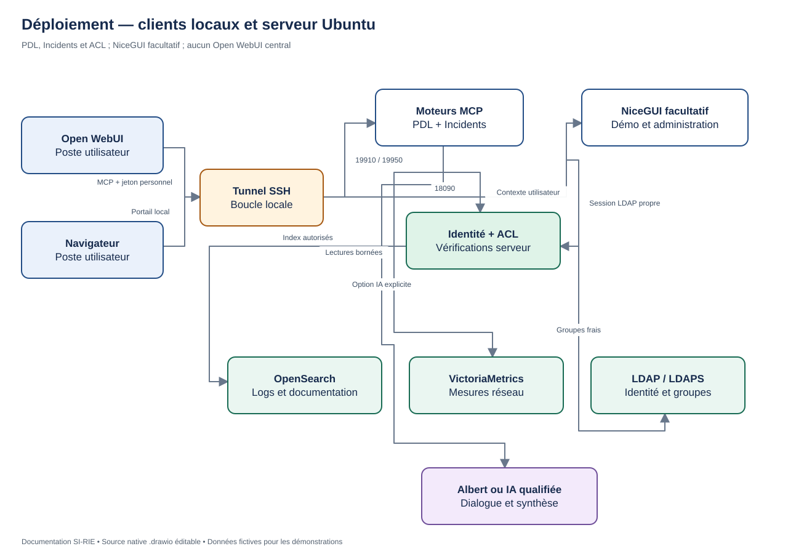
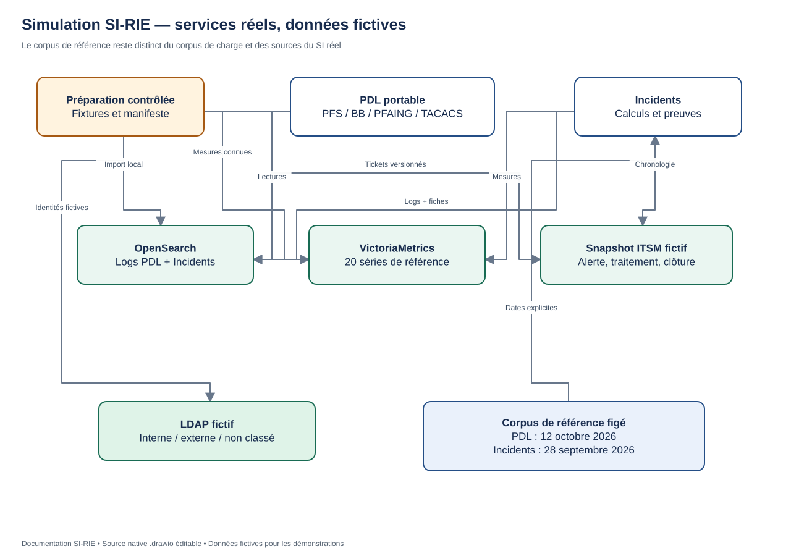
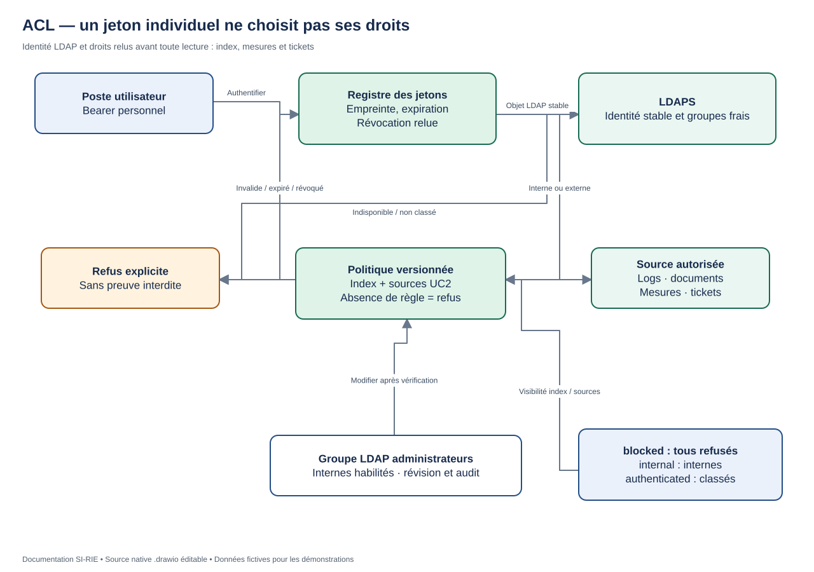

# Architecture des deux UC et des ACL

Le client dialogue avec Open WebUI sur son poste. Les moteurs PDL et Incidents
exécutent les lectures et contrôles sur le serveur Ubuntu. Le modèle propose
une intention ou une synthèse ; il ne choisit pas les droits et ne reçoit pas
un accès libre aux sources.

[Source draw.io du déploiement](diagrams/01-deployment.drawio)

## Composants

| Composant | Responsabilité |
| --- | --- |
| Open WebUI local | Conversation, choix du preset et appel MCP avec le jeton personnel |
| MCP PDL | Dialogue lié au sujet, validation du plan, compilation et preuves |
| MCP/HTTP Incidents | Périmètre, calculs de mesures, chronologie, recherche documentaire et synthèse contrôlée |
| Contrôle d'accès partagé | Authentification du jeton, identité LDAP fraîche et politique des index et sources UC2 |
| OpenSearch | Logs PDL, logs Incidents et fiches documentaires |
| VictoriaMetrics | Mesures réseau lues par le diagnostic |
| LDAP | Identité stable et groupes interne/externe |
| NiceGUI facultatif | Présentation, preuves autorisées, documentation, administration des droits et consultation des rapports de qualification |

Les ports publiés sont liés à la boucle locale du serveur. Le poste les atteint
par tunnel SSH. En mode `demo`, les sources privées de l’instance n’ont pas de
port hôte publié. En mode `external`, leurs adresses et protections sont fournies
par le SI ; la sandbox utilise une passerelle HTTPS et un accès LDAPS séparés.
Les paramètres privés restent dans le dossier d’instance ; les données métier
du PoC vivent dans ses volumes, pas dans le checkout.

## Services déployés en mode external

Un **service** désigne ici un processus géré par Docker Compose. Les services
`pdl`, `incidents` et `operator` partagent une image runtime ; cela ne les
fusionne pas en un même processus. NiceGUI utilise une image dérivée facultative.

| Service | Rôle et données utilisées | Utilisation | Durée et accès |
| --- | --- | --- | --- |
| `pdl` | Moteur Python PDL : dialogue et clarifications, plan Albert, contrôle des ACL, catalogue de mappings approuvés, compilation des recherches OpenSearch et restitution avec preuves. | L’utilisateur choisit son modèle PDL dans Open WebUI ou utilise la démo PDL NiceGUI. L’opérateur prépare le catalogue avec `manage.py pdl`. | Durable ; Ubuntu `127.0.0.1:19910/mcp` ; outil `investigate_pdl`. |
| `incidents` | Moteur Python Incidents : mesures VictoriaMetrics, logs et documents OpenSearch, snapshot des alertes/traitements, précédents ITSM-NG si raccordés. Il calcule les faits puis fait rédiger et relire la synthèse par Albert. | L’utilisateur choisit le modèle Incidents dans Open WebUI ou « Diagnostiquer avec Albert API » dans NiceGUI, avec équipement et période. | Durable ; Ubuntu `127.0.0.1:19950/gptoss/assistant/mcp` pour le dialogue ; outil `diagnose_observability`. |
| `portal` | Portail NiceGUI : démos PDL/Incidents, preuves accessibles au titulaire, documentation, administration ACL et catalogue des rapports de qualification importés. | Navigateur avec connexion LDAP ; fonctionnalités selon le rôle. Le portail utilise les moteurs, il ne les remplace pas. | Durable si activé ; Ubuntu `127.0.0.1:18090`. Tunnel Mac de l’exercice : `http://127.0.0.1:28090`. |
| `initialize` | Prépare les répertoires et permissions des volumes et y copie les paramètres/secrets de l’instance. Conserve les états métier et n’écrase pas la politique déjà initialisée. | Appelé automatiquement par `manage.py up`, avant les moteurs. Aucune opération manuelle dans son conteneur n’est nécessaire. | Ponctuel, exécuté avec les droits requis pour ses volumes ; sans réseau ni port web. |
| `operator` | Fournit les bibliothèques Python et commandes d’administration : contrôles métier, catalogue PDL, règles et consultation/révocation des jetons. | Appelé au besoin par `manage.py check`, `pdl`, `policy`, `list-tokens` ou `revoke-token`. Le déployeur emploie `manage.py` avec ses droits Ubuntu. | Ponctuel ; termine après la commande, sans port publié. |

Les noms complets de conteneurs incluent le projet de l’instance, par exemple
`rie-5ccf2ce0d183-pdl-1`. Dans la documentation et `manage.py`, utiliser les noms
de service (`pdl`, `incidents`, `portal`) plutôt que recopier ces identifiants.

**Le contrôle ACL est une bibliothèque partagée**, pas un conteneur supplémentaire.
Les deux moteurs vérifient les jetons, l’identité et les groupes LDAP, puis
les droits sur les index et les ressources `incidents.metrics` et
`incidents.tickets`. NiceGUI permet leur administration aux comptes habilités ;
une règle interdite reste opposable à un administrateur.

**Open WebUI est le client local du poste utilisateur.** Il appelle les outils
MCP avec le jeton personnel ; aucun serveur Open WebUI central n’est installé
sur Ubuntu. **Albert est un fournisseur externe appelé par HTTPS** selon la
configuration ; le déploiement ne lance pas un serveur de modèles Albert.

### Distinguer les services du SI et le stockage du PoC

En `external`, OpenSearch, VictoriaMetrics, LDAP et ITSM-NG appartiennent au SI
existant. Dans la sandbox, ils sont préparés dans un projet Docker indépendant,
avec MariaDB pour ITSM-NG et une passerelle Nginx sur Ubuntu. Les moteurs du PoC
les consultent par les adresses de la fiche de raccordement ; ils ne les créent
pas, ne les initialisent pas et ne les arrêtent pas par `manage.py stop`.

Le **volume `runtime`** du PoC conserve notamment configuration, secrets,
politique, jetons, mappings, rapports et états de conversation. Un volume
`ldap` peut être créé par l’initialiseur commun même en `external` ; il ne
constitue pas un serveur LDAP ni un raccordement supplémentaire. Un volume
de stockage et un conteneur en exécution sont deux objets Docker différents.

### Comprendre les contrôles d’exploitation

| Contrôle | Ce qu’il démontre | Comment l’utiliser |
| --- | --- | --- |
| `manage.py status` | Présence des conteneurs et santé de leurs processus. | Vérifier `pdl`, `incidents` et `portal` si activé. `healthy` ne prouve pas une lecture des sources. |
| `manage.py check` | Connexion LDAP, accès aux dépendances, contrats Incidents et couverture des mappings PDL. | En `external`, fournir `--username` avec l’administrateur LDAP retenu. Lire chaque dépendance et source requise, pas seulement le statut global. |
| `manage.py logs` | Journaux d’un service pour expliquer une erreur. | Choisir `--service pdl`, `incidents` ou `portal` et un nombre de lignes ; examiner les extraits en privé. |
| `manage.py storage` | Occupation disque et croissance des états/rapports. | Contrôle sans suppression ni purge automatique. |
| Recette avec Albert | Génération réellement exécutée et pertinence des réponses. | Jouer les demandes dans NiceGUI/Open WebUI, puis vérifier modèles, usages, preuves et limites du rapport. |

`healthy_not_initialized` est attendu avant approbation des mappings **si les
connexions aux sources sont fonctionnelles**. Des dépendances `unavailable`
ou `unavailable_or_denied` restent à corriger avant de poursuivre ; elles
peuvent coexister avec ce statut global. L’[exploitation](07-operations.md)
détaille les commandes, et le [déroulé continu](24-deploy-walkthrough.md) donne
l’ordre de la recette.

## Diagrammes des démonstrations NiceGUI

Les quatre figures suivantes reprennent les diagrammes Mermaid présentés dans
les démonstrations NiceGUI **PDL en 5 minutes** et **Incidents en 5 minutes** :
les composants applicatifs, puis le déroulement complet d'une demande.
Chaque fichier **draw.io est éditable** : blocs, décisions, groupes et flèches
restent des objets distincts. Le SVG permet de zoomer sans perte de qualité ;
le PNG permet de réutiliser l'image dans un support de présentation.

Accès direct : [composants PDL](#uc-pdl--composants) ·
[parcours PDL](#uc-pdl--déroulement-dune-demande) ·
[composants Incidents](#uc-incidents--composants) ·
[parcours Incidents](#uc-incidents--déroulement-dune-demande) ·
[ACL communes](#frontières-de-confiance).

**Périmètre des figures.** La conversion conserve le contenu des guides des
démos ; elle ne transforme pas leur configuration historique en configuration
Ubuntu. Pour cette recette, les différences à appliquer sont les suivantes :

| Sujet | Démonstrations représentées | Recette Ubuntu |
| --- | --- | --- |
| Dialogue PDL | Filtre `pdl_evidence_guard` et catalogue YAML du moteur historique Mac | Dialogue et jeton de reprise gérés par le moteur portable ; inventaire et mappings approuvés côté serveur |
| Accès aux sources | Les figures des UC détaillent le traitement métier | Jeton personnel, identité LDAP et politique commune vérifiés avant les lectures ; voir les ACL ci-dessous |
| Modèle et endpoint Incidents | Guide historique avec synthèse Gemma et liens Grafana | Endpoint `/gptoss/assistant/mcp` ; modèles selon la configuration de l'instance et lecteurs web facultatifs |

Les contrats de la livraison sont détaillés dans [Technique PDL](04-pdl.md),
[Technique Incidents](05-incidents.md) et [ACL](06-acl.md).

### UC PDL — composants

Albert propose le plan métier et la synthèse. Le serveur Python pilote les
étapes, traduit les concepts en requêtes OpenSearch et conserve les preuves.
Les flèches pointillées représentent la configuration des adaptateurs.

[Télécharger draw.io éditable](diagrams/09-pdl-demo-architecture.drawio) ·
[Ouvrir le SVG en grand](assets/diagrams/09-pdl-demo-architecture.svg) ·
[Télécharger le PNG](assets/diagrams/09-pdl-demo-architecture.png) ·
[Source Mermaid](sources/09-pdl-demo-architecture.mmd)

### UC PDL — déroulement d'une demande

Le parcours explicite les clarifications, les contrôles du plan et la résolution
d'identité d'un équipement. Il distingue les lectures réussies des preuves
partielles avant la synthèse, la critique et la restitution.

[Télécharger draw.io éditable](diagrams/10-pdl-demo-flow.drawio) ·
[Ouvrir le SVG en grand](assets/diagrams/10-pdl-demo-flow.svg) ·
[Télécharger le PNG](assets/diagrams/10-pdl-demo-flow.png) ·
[Source Mermaid](sources/10-pdl-demo-flow.mmd)

### UC Incidents — composants

Le serveur possède le dialogue et les contrôles. Il lit les mesures, logs,
tickets et fiches documentaires autorisés, calcule les faits et transmet les
preuves à Albert pour la synthèse et sa relecture.

[Télécharger draw.io éditable](diagrams/11-incidents-demo-architecture.drawio) ·
[Ouvrir le SVG en grand](assets/diagrams/11-incidents-demo-architecture.svg) ·
[Télécharger le PNG](assets/diagrams/11-incidents-demo-architecture.png) ·
[Source Mermaid](sources/11-incidents-demo-architecture.mmd)

### UC Incidents — déroulement d'une demande

Le parcours montre la reprise du dialogue, la clarification ou le refus avant
lecture, puis la collecte des preuves et les contrôles de la synthèse. Les faits
restent disponibles même lorsque la synthèse ne peut pas être validée.

[Télécharger draw.io éditable](diagrams/12-incidents-demo-flow.drawio) ·
[Ouvrir le SVG en grand](assets/diagrams/12-incidents-demo-flow.svg) ·
[Télécharger le PNG](assets/diagrams/12-incidents-demo-flow.png) ·
[Source Mermaid](sources/12-incidents-demo-flow.mmd)

## Images et outils de déploiement

Les services PDL et Incidents, ainsi que l’opérateur, partagent la même image
runtime minimale. Ils restent des processus et conteneurs distincts. Le portail
facultatif est une image dérivée qui ajoute NiceGUI et la documentation ; sans
portail, ces dépendances ne sont pas requises. L’image de qualification ajoute
les outils de charge et d’injection de panne uniquement sur demande explicite.
Aucun outil de qualification n’est ajouté au contrat MCP métier.

Les suites Python et Playwright produisent leurs résultats sur le poste de
qualification ou le runner CI. Allure y génère un rapport HTML autonome. Après
import opérateur, NiceGUI lit seulement les publications sélectionnées sous
`INSTANCE/qualification`, montées en lecture seule. L'accès demande une identité
LDAP interne habilitée à l'administration. Les moteurs et le portail n'installent
ni Node.js ni le générateur Allure ; voir [Rapports de tests](13-test-reports.md).

La politique distingue les index concrets des deux ressources UC2
`incidents.metrics` et `incidents.tickets`. Le diagnostic complet exige les
quatre droits configurés ; une autorisation absente refuse la lecture.
Voir [ACL et migration](06-acl.md).

## Simulation

[Source draw.io de la simulation](diagrams/02-simulation.drawio)

Le corpus PDL structuré contient PFS, Backbone, PFAING et TACACS. Le corpus
Incidents combine mesures VictoriaMetrics, logs OpenSearch, fiches historiques
et tickets simulés. Les périodes de référence sont fixes : 12 octobre 2026
pour le PDL portable, 28 septembre 2026 pour Incidents.

Le corpus de charge est distinct du corpus des démonstrations. Il reproduit des
volumes et des changements contrôlés, sans représenter des équipements réels.
Les résultats de charge s'interprètent avec la taille, la cadence, la machine
et le profil IA enregistrés dans le rapport.

## Frontières de confiance

Ce contrôle est commun aux deux UC de la recette Ubuntu. Il complète les
diagrammes métier des démonstrations ci-dessus.

[Télécharger draw.io des ACL](diagrams/05-identity-acl.drawio) ·
[Ouvrir le SVG en grand](assets/diagrams/05-identity-acl.svg) ·
[Télécharger le PNG](assets/diagrams/05-identity-acl.png)

Un poste utilisateur ne possède aucune clé de signature commune. Il présente
son jeton individuel. Le backend vérifie son empreinte, son expiration et sa
révocation, puis relit l'objet LDAP et ses groupes. La politique est réévaluée
avant les lectures autorisées.

Le compte technique OpenSearch ne remplace pas la politique applicative.
Inversement, les ACL applicatives ne remplacent ni les droits natifs des sources,
ni la protection du serveur et de ses consoles. Un opérateur Docker possède
un rôle administratif sur cet hôte.

Les contenus de logs, tickets et documents restent des données non fiables.
Ils ne doivent pas devenir des instructions. Les résultats conservés sont des
preuves datées ; une ancienne autorisation ou un ancien diagnostic ne vaut
pas lecture courante.

## Disponibilité et état

Le système distingue processus vivant, configuration chargée, corpus initialisé,
sources disponibles et génération IA validée. Une panne d'une dépendance doit
rester visible. L'absence de Grafana ou d'un lecteur web facultatif ne rend pas
une source métier indisponible et ne justifie aucun lien fictif.

La persistance locale des catalogues, politiques et rapports n'est pas une base
transactionnelle commune à tous les composants. Les procédures de sauvegarde
et de reprise travaillent donc à froid. Voir [Exploitation](07-operations.md).

## Retrouver le code

Les moteurs sont `use-cases/pdl/agentic-pdl/rie_agent/` et
`use-cases/incidents/observability-demo/obs_poc/`. Les contrôles partagés sont
dans `core/access-control/src/dinum_access/`, le client et le dialogue Albert
dans `core/albert-client/src/dinum_albert/`, le déploiement dans `deploy/ubuntu/`.

Le moteur PDL historique Mac reste dans le dépôt pour ses anciennes démos.
Le profil Ubuntu utilise le moteur portable ; il ne doit pas relire le catalogue
Mac ni présenter ses captures comme une exécution de cette instance.
