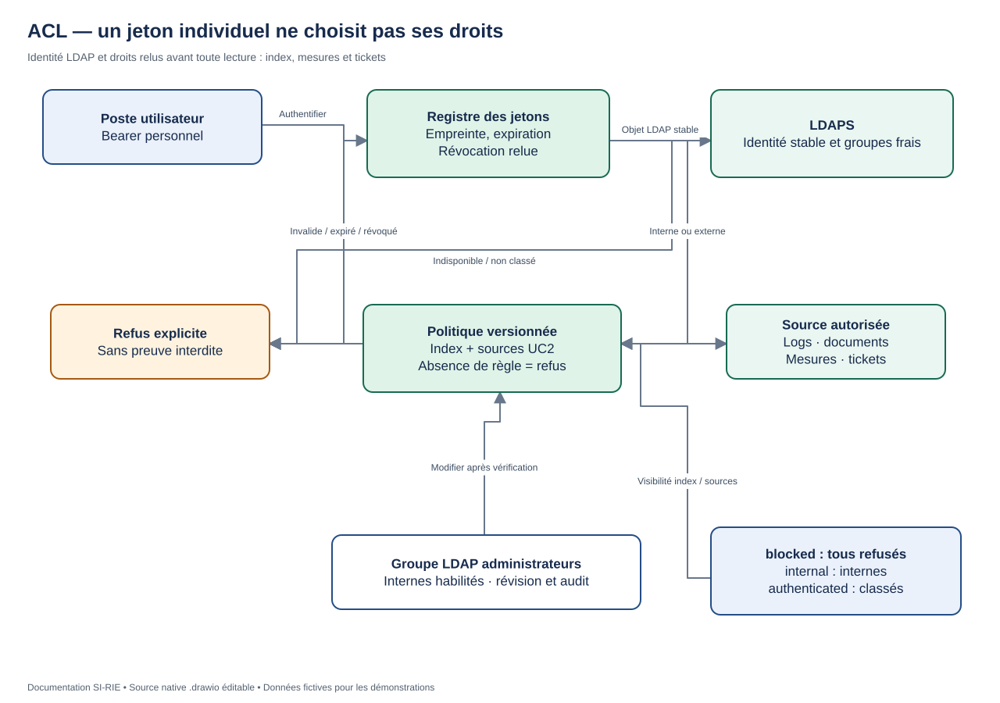

# ACL : identité individuelle, rôles et sources

Le modèle ne détermine aucun droit. Une lecture protégée utilise l'identité
vérifiée, les groupes LDAP **actuels** et la politique active. Un administrateur
reste soumis à une interdiction explicite. Les contrats MCP ne reçoivent ni
mail ni rôle déclaratif pour accorder un accès.



[Source draw.io](diagrams/05-identity-acl.drawio)

## Identité et jeton personnel

Pour le parcours utilisateur courant, la [connexion OAuth avec LDAP](25-user-access.md)
évite toute copie manuelle de jeton MCP. Open WebUI conserve l'autorisation
individuelle et renouvelle les accès courts ; les groupes LDAP, l'identité
stable et les ACL restent relus côté serveur. La connexion à Open WebUI
seule ne remplace pas encore l'autorisation initiale des sources. Les jetons
personnels décrits ci-dessous restent compatibles pour les scripts et clients
historiques ; leur cycle de révocation reste distinct des sessions OAuth.

Chaque utilisateur conserve son Open WebUI local et reçoit un jeton opaque,
révocable, lié à son objet LDAP stable. Le serveur stocke l'empreinte du secret,
son échéance et sa révocation. À chaque appel, il relit le registre et le LDAP.
Un compte supprimé puis recréé sous le même nom n'hérite pas de ses anciens jetons.

Conserver `allow_webui_assertions: false`. Ne distribuer aucune clé capable de
signer librement un utilisateur. Les en-têtes de nom, mail ou rôle n'accordent
pas d'accès. Le jeton technique intérieur d'un service ne devient jamais une
identité utilisateur partagée. Un compte non classé ou dans les deux groupes
interne/externe est refusé.

## Séparer lecteur interne et administrateur

La catégorie `internal` autorise les lectures réservées aux internes ; elle
ne donne aucun droit d'administration. `ldap.administrator_group_dns` contient
les DN complets des groupes d'administration autorisés. Le compte doit être
**interne et membre direct d'au moins un de ces groupes**. Une liste absente ou
vide n'accorde l'administration à personne. Un DN de classification interne ou
externe ne peut pas servir de groupe administrateur : la configuration le refuse.

Les appartenances sont relues dans la même réponse LDAP que l'identité à chaque
appel, y compris avec un ancien jeton ou une session déjà ouverte. Ajouter ou
retirer le groupe administrateur prend effet à la prochaine opération. Un rôle
transmis par le navigateur, Open WebUI ou le modèle n'accorde rien. Les groupes
imbriqués ne sont pas développés automatiquement.

L'administration NiceGUI des ACL et des mappings PDL (`/admin-mappings`),
les commandes de modification de politique et les
rapports de qualification exigent ce rôle distinct. L'interne lecteur peut
continuer à utiliser les deux UC selon leurs règles de sources. La gestion des
secrets et des sauvegardes par l'opérateur système reste une responsabilité de
l'hôte Ubuntu, avec ses droits système habituels.

Dans **Mappings PDL**, ce rôle est exigé avant la lecture des schémas et des
revues. Les droits des index sont également vérifiés : un administrateur ne lit
ni n’approuve un index `blocked`. Une perte de groupe ou une expiration de
session retire les contrôles lors de l’action suivante. Valider/enregistrer une
proposition ne l’active pas ; la confirmation métier et le motif d’approbation
restent explicites et l’auteur provient du LDAP.

### Mettre à jour une ancienne configuration

Cette évolution n'ajoute aucun groupe ni membre à un annuaire existant. Les
anciens jetons personnels restent valides pour leurs lectures, mais les anciens
internes n'obtiennent plus l'administration par leur seule catégorie.

Sur le **serveur Ubuntu**, opérateur avec `sudo`, après préparation des nouvelles
images selon [la procédure de mise à jour](07-operations.md) :

1. Sauvegarder l'instance avant le changement ; conserver le chemin de la
   sauvegarde et la version des anciennes images.
2. Faire créer ou confirmer par l'administrateur LDAP un **groupe distinct**
   d'administration et y inscrire le compte interne choisi. Obtenir son DN réel
   et vérifier que son `memberOf` direct est lisible par le compte LDAP lecteur.
3. Modifier seulement le fichier privé de configuration :

```bash
# Ouvre la configuration privée des accès dans votre éditeur pour renseigner le LDAP et les groupes habilités.
sudoedit "$RIE_INSTANCE/config/access.json"
```

Dans son objet `ldap`, ajouter la liste avec les DN confirmés ; cet exemple est
illustratif, pas une valeur SI-RIE à recopier :

```json
"administrator_group_dns": ["cn=Administrateurs-Acces,ou=groupes,dc=exemple,dc=interne"]
```

4. Valider, redémarrer avec les images préparées et contrôler avec ce compte :

```bash
# Contrôle les fichiers et paramètres privés avant application ; ne démarre rien et n'appelle pas Albert.
sudo python3 deploy/ubuntu/manage.py validate "$RIE_INSTANCE"
# Démarre ou relance les services de cette instance et recharge sa configuration en conservant ses données.
sudo python3 deploy/ubuntu/manage.py up "$RIE_INSTANCE"
# Sonde les sources, le LDAP et les mappings ; ready signifie disponibilité métier, sans validation de génération Albert.
sudo python3 deploy/ubuntu/manage.py check "$RIE_INSTANCE" --username LDAP_ADMIN_USERNAME
```

Attendu : validation de configuration, puis disponibilité des sources et du
compte administrateur. `validate` ne prouve pas une appartenance LDAP réelle.
Si `administrator_required` apparaît, vérifier les DN, l'appartenance directe et
le classement interne avec l'administrateur d'annuaire ; ne pas remplacer la
liste par le groupe de tous les internes. Rejouer la connexion NiceGUI et vérifier
un interne lecteur, un administrateur et un externe avant remise.

Une **nouvelle** simulation prépare Alice dans le groupe dédié et Bruno lecteur.
Une ancienne simulation garde son LDAP initial : `up` ne promeut pas Alice et
ne crée pas Bruno. Pour les nouvelles recettes de laboratoire, préparer une
instance neuve selon l'installation ; conserver l'ancienne instance et sa
sauvegarde. Toute modification d'un LDAP existant suit sa procédure d'administration.

## Ce qui est protégé

| Objet de politique | Lectures contrôlées |
| --- | --- |
| `indices.PHYSICAL_INDEX_NAME` | Index PDL et index de logs/documents Incidents ; chaque index concret du rapprochement est vérifié |
| `resources.incidents.metrics` | Lectures VictoriaMetrics de l'UC Incidents |
| `resources.incidents.tickets` | Snapshot de tickets Incidents et recherche historique ITSM-NG facultative, solutions, suivis et extraits du rapport |
| `resources.pdl.zabbix.host.ID` | Métadonnées de l'hôte Zabbix exact, si le connecteur facultatif est activé |
| `resources.pdl.grafana.dashboard.UID` | Résumé et expressions textuelles des panneaux du tableau exact, si le connecteur facultatif est activé |

Les visibilités sont `blocked` (personne), `internal` (internes) et
`authenticated` (internes ou externes classés). **Une règle absente est
interdite.** Les noms de ressources sont exacts, sans joker ; ils ne sont pas des index
OpenSearch. Les droits natifs des comptes lecteurs de chaque
source restent à configurer par le SI en complément.

Le [connecteur historique ITSM-NG 1.6.17](15-itsm-precedents.md) utilise des
credentials individuels liés au sujet LDAP stable et vérifie l'identité native.
La règle générale ne contourne pas les profils/entités ITSM ni les droits des
suivis privés. Un contenu interdit ne contribue ni à la solution ni à sa confiance.

Le diagnostic Incidents complet exige quatre autorisations : son index de
logs, son index documentaire, `incidents.metrics` et `incidents.tickets`.
Si l'une manque, il refuse sans preuve, sans lecture opportuniste des autres
sources. Les lecteurs ciblés de logs, documents, métriques ou tickets vérifient
le droit de leur propre source. Un droit refusé n'est pas traité comme une panne.
Une source autorisée mais indisponible peut produire un résultat partiel
explicitement signalé ; elle ne permet pas de recycler une ancienne preuve.

Les sources standard des deux UC ne proposent pas d'ACL par équipement, site,
tenant ou période. L'inventaire `allowed` et les sélecteurs métier limitent le corpus
exploitable globalement ; ils ne constituent pas une politique individuelle
supplémentaire. Une telle granularité demande un développement et une recette
propres avant d'être annoncée au SI.

Les trois configurations restent indépendantes : LDAP/jeton pour l'identité,
catalogue/mapping pour le sens des données, politique pour les droits. Un
mapping approuvé n'accorde aucun droit.

## Émettre, renouveler et révoquer

Sur le **serveur**, avec l'opérateur autorisé à administrer l'instance :

```bash
# Émet un jeton pour ce seul titulaire LDAP et le sauvegarde dans un fichier privé ; ne l'affiche pas.
sudo python3 deploy/ubuntu/manage.py issue-token "$RIE_INSTANCE" --username LDAP_USERNAME
# Liste les métadonnées et états des jetons de l'instance, sans afficher leur valeur secrète.
sudo python3 deploy/ubuntu/manage.py list-tokens "$RIE_INSTANCE"
```

Attendu : l'émission vérifie le compte LDAP et écrit un nouveau fichier `0600`,
sans afficher le secret. La durée par défaut est de 30 jours ; `--days` accepte
1 à 90 jours. Remettre le fichier au seul titulaire par le canal interne prévu.

Pour renouveler, utiliser `issue-token` avec `--output` vers un **nouveau**
fichier dans un dossier privé, remplacer le jeton sur le poste puis révoquer
l'ancien identifiant retourné par `list-tokens` :

```bash
# Révoque l'identifiant du jeton choisi ; les appels suivants utilisant ce jeton seront refusés.
sudo python3 deploy/ubuntu/manage.py revoke-token "$RIE_INSTANCE" --id OLD_TOKEN_ID
```

Ne pas révoquer le nouveau jeton par confusion. Les copies sur le poste suivent
les règles de stockage internes ; aucun Bearer ne doit apparaître dans une URL,
une capture ou un ticket.

## Préparer une connexion fictive

**Mode `demo` uniquement**, sur le serveur : les mots de passe NiceGUI sont
aléatoires. Les uid d’une nouvelle instance sont `alice.martin` (interne
administratrice), `bruno.lecteur` (interne lecteur), `eric.durand.ext` (externe) et
`camille.inconnue` (non classé). Ils ne partagent pas un mot de passe universel.

```bash
# En demo uniquement, prépare un fichier privé contenant le seul compte fictif demandé, sans afficher son mot de passe.
sudo python3 deploy/ubuntu/manage.py demo-credentials "$RIE_INSTANCE" --username alice.martin
```

Attendu : chemin d'un fichier privé, par défaut
`clients/alice.martin.credentials.json`, sans mot de passe dans la sortie.
Le fichier contient **ce seul** identifiant et mot de passe, pas les secrets
lecteur ou administrateur LDAP. Le consulter dans un éditeur privé (`sudoedit`
si nécessaire), puis transmettre au seul démonstrateur concerné. Pour une autre
émission, préciser `--output` vers un nouveau fichier privé ; aucun écrasement
implicite n'est autorisé. Retirer ces copies de remise après la séance selon la
politique locale, en conservant les originaux privés nécessaires au laboratoire.

Le jeton Open WebUI et le mot de passe LDAP NiceGUI sont deux secrets différents.
Un jeton ne se saisit pas dans le formulaire de connexion du portail. En
`external`, ce récupérateur est refusé : le titulaire utilise son mot de passe
LDAP connu et suit la procédure d'assistance du SI.

## Lire et modifier la politique active

Sur le serveur, commencer par lire la révision avec un identifiant LDAP administrateur :

```bash
# Lit la politique ACL et sa révision courante avant de décider une modification.
sudo python3 deploy/ubuntu/manage.py policy "$RIE_INSTANCE" --username LDAP_ADMIN_USERNAME -- list
```

Une modification d'index conserve le contrat existant :

```bash
# Modifie le droit de ce seul index avec la révision lue ; les autres règles restent en place.
sudo python3 deploy/ubuntu/manage.py policy "$RIE_INSTANCE" --username LDAP_ADMIN_USERNAME -- set INDEX_NAME internal --revision POLICY_REVISION
```

Une modification de source UC2 emploie la commande dédiée :

```bash
# Modifie le droit de cette seule ressource avec la révision lue ; une modification concurrente est refusée.
sudo python3 deploy/ubuntu/manage.py policy "$RIE_INSTANCE" --username LDAP_ADMIN_USERNAME -- set-resource incidents.metrics internal --revision POLICY_REVISION
```

Attendu : nouvelle révision et règle choisie. Relire `list` avant la modification
suivante. En cas de conflit, relire et décider à nouveau ; ne pas réutiliser une
ancienne révision. `remove` retire une règle d'index ; `remove-resource` retire
une règle de source, qui redevient donc interdite. Aucun de ces retraits ne
supprime les données de la source.

NiceGUI permet les mêmes modifications d'index et de sources Incidents après
connexion LDAP avec le groupe d'administration dédié. La session propre au navigateur dure au maximum dix minutes,
reste liée à l'objet LDAP stable et relit les groupes avant une modification.
L'interne lecteur et l'externe ne disposent pas d'un chemin administratif
opérationnel.

Si une action constate que la session est inactive, le portail retire
l'identité affichée, les résultats et les anciens contrôles, puis affiche
**« Session inactive. Reconnectez-vous pour poursuivre. »**. Ressaisir le mot
de passe LDAP, cliquer sur **« Se connecter »**, relire la révision active et
resélectionner la règle avant de l'enregistrer. Une tentative refusée ne change
pas la politique. Les erreurs de règle ou de révision sont aussi signalées par
une notification visible ; un conflit de révision conserve une session valide.

### Reconnaître un refus dans NiceGUI

Sur `/demo-acces`, avec la politique de démonstration initiale, le compte
`eric.durand.ext` peut consulter les quatre index PDL, mais aucune ressource
Incidents. Le bouton **« Tester les preuves Incidents avec mon identité »**
doit afficher **« Résultat · denied »** et une réponse contenant
`status: denied`, `code: access_denied`, `category: external` et
`allowed_resources: []`. Les listes de preuves, sources, mesures, événements,
logs et documents doivent être vides.

Ce refus métier peut être transporté par une réponse HTTP 200 : le statut HTTP
seul ne valide donc pas le diagnostic. Le message **« Le backend refuse cette
identité ou cette lecture. »** correspond aux erreurs HTTP 401/403 reçues par
le portail ; sa présence n'est pas requise pour le refus métier ci-dessus.

## Connecteurs PDL facultatifs Zabbix et Grafana

Ils restent **désactivés** dans le profil Ubuntu standard. Leur activation exige
un compte de source en lecture seule, sa configuration TLS, les identifiants
réels des objets et des règles explicites approuvées. La règle porte sur le
contenu de l'objet : confirmer aussi que les expressions des tableaux ne
contiennent aucun secret métier ou credential qui ne devrait pas être partagé.

Sous contrôle d'accès actif, le sous-ensemble pris en charge est volontairement
borné :

| Opération | Portée obligatoire | Contenu publié |
| --- | --- | --- |
| Zabbix `host.get` | `hostids` explicites, 1 à 50 identifiants décimaux | `hostid`, `host`, `name`, `status` ; pas d'extension vers interfaces, items ou secrets |
| Grafana `get_dashboard_summary` | Un `uid` exact | Identité, titre et métadonnées simples des panneaux ; aucune configuration de datasource |
| Grafana `get_dashboard_panel_queries` | Un `uid` exact, sans substitution de variable | Expressions textuelles et UID/type de datasource ; les targets de constructeurs visuels sont refusées |

Les recherches globales, listings de datasources, requêtes de données, lectures
Zabbix d'items/historique/alertes et arguments supplémentaires restent refusés
sous identité active. Les droits sont vérifiés **avant l'appel**, tous les objets
d'une demande devant être autorisés ; une réponse Zabbix hors périmètre ou un
résumé Grafana d'un autre UID est rejeté. Les champs non prévus de la réponse
sont retirés. Ces bornes ne valent pas qualification des versions réelles du SI.

Les règles facultatives se gèrent par la commande opérateur existante, après
lecture de la révision ; remplacer les identifiants d'exemple :

```bash
# Modifie le droit de cette seule ressource avec la révision lue ; une modification concurrente est refusée.
sudo python3 deploy/ubuntu/manage.py policy "$RIE_INSTANCE" --username LDAP_ADMIN_USERNAME -- set-resource pdl.zabbix.host.10001 internal --revision POLICY_REVISION
# Lit la politique ACL et sa révision courante avant de décider une modification.
sudo python3 deploy/ubuntu/manage.py policy "$RIE_INSTANCE" --username LDAP_ADMIN_USERNAME -- list
# Modifie le droit de cette seule ressource avec la révision lue ; une modification concurrente est refusée.
sudo python3 deploy/ubuntu/manage.py policy "$RIE_INSTANCE" --username LDAP_ADMIN_USERNAME -- set-resource pdl.grafana.dashboard.rie-network internal --revision NEW_POLICY_REVISION
```

Une règle absente ou retirée refuse l'objet. Les décisions partagent la révision
et l'audit des sources Incidents ; un administrateur ne contourne pas `blocked`.
Le SI doit vérifier la correspondance ID/UID, l'organisation/tenant du compte
technique et les droits natifs de chaque source. Références des contrats :
[Zabbix host.get](https://www.zabbix.com/documentation/7.2/en/manual/api/reference/host/get)
et [outils de tableaux Grafana](https://grafana.com/docs/grafana/latest/ai-tools/mcp/guides/search-and-inspect-dashboards/).

## Reprendre une politique antérieure aux droits de sources UC2

Une **nouvelle** démo initialise explicitement les deux ressources à `internal`.
La reprise d'une ancienne politique n'ajoute aucun accès : les règles de
ressources absentes restent refusées. Avant de rendre Incidents aux utilisateurs :

1. Sauvegarder l'instance selon [Exploitation](07-operations.md).
2. Faire confirmer par le responsable les visibilités de métriques et tickets.
3. Lire la politique et ajouter la première ressource avec la révision lue.
4. Relire la nouvelle révision, puis ajouter la seconde ressource.
5. Vérifier interne, externe et refus attendu avant remise.

Utiliser `set-resource incidents.metrics ...` puis
`set-resource incidents.tickets ...`, avec les visibilités réellement approuvées.
Ne pas recopier `access/policy.json` depuis un modèle pour changer une politique
active : ce fichier ne sert qu'à la première initialisation, et `up` préserve
ensuite la politique active.

## Refus et preuves de validation

La recette doit refuser identité absente, jeton invalide/expiré/révoqué, LDAP
indisponible, compte recréé, groupe ambigu, index ou ressource absent/interdit,
et reprise de conversation appartenant à un autre utilisateur. Les décisions
d'audit n'enregistrent ni question, ni mot de passe, ni contenu métier libre.
Les résultats et leur version sont dans [Qualification](08-qualification.md).
