# Prendre en main les UC — démonstration et sources SI-RIE

**Les noms de comptes, équipements, index et résultats chiffrés des démonstrations
sont fictifs. Ils ne sont pas annoncés comme disponibles dans le SI-RIE.**
Le tutoriel propose deux parcours selon les sources de l'instance :

| Objectif | Conditions et données utilisées |
| --- | --- |
| Apprendre avec un exemple reproductible | Instance isolée `demo`, annuaire et corpus initialisés avec succès : comptes et données fictifs fournis par le paquet |
| Utiliser le PoC sur les sources SI-RIE | Instance `external` configurée et raccordée : comptes LDAP, droits, équipements, périodes et références fournis par les responsables du SI |

Une instance `demo` peut être hébergée sur une machine du SI-RIE tout en utilisant
uniquement ses sources fictives. À l'inverse, le mode `external` ne crée ni
Alice/Bruno/Eric, ni `edge-a`, ni R1, ni leurs événements. Faire confirmer le mode
et l'état d'initialisation par l'installateur ; afficher la documentation ne
vérifie pas que ces comptes et ces données existent.

Le portail NiceGUI se consulte depuis le navigateur du poste par tunnel
local ; les conversations ont lieu dans l'Open WebUI présent sur ce poste.
Une capture historique Mac reste une illustration historique, jamais le résultat
d'un appel à la VM courante.

## Tutoriels de prise en main

Les démos PDL et Incidents proposent un **tutoriel pas à pas avec questions
copiables**, indications « nouveau fil / même fil » et résultats à observer.
Ces mêmes parcours sont disponibles dans la documentation et l'export Wiki.js :

| Tutoriel | Ce qu'il permet d'apprendre |
| --- | --- |
| [PDL — questions et preuves](16-pdl-tutorial.md) | Comptage PFS, rapprochements, suivi TACACS, recherche PFAING par IP, clarification, résultat vide et exercice ACL interne/externe sur TACACS |
| [Incidents — diagnostic et suivi](17-incidents-tutorial.md) | R1, ticket, Rennes, données manquantes de R3, clarification, refus R4, précédents ITSM et exercice ACL sur les quatre sources |

Chaque tutoriel comprend son propre exercice ACL :
[restriction puis rétablissement de TACACS](16-pdl-tutorial.md#9-vérifier-les-acl-pdl)
et [retrait puis rétablissement d'une source Incidents](17-incidents-tutorial.md#9-vérifier-les-acl-incidents).
Ils distinguent l'interne lecteur, l'externe et l'administratrice, avec les
résultats attendus avant et après modification de la règle.

**Pour les sources réelles**, commencer par
[PDL avec vos sources SI-RIE](16-pdl-tutorial.md#utiliser-vos-sources-si-rie) ou
[Incidents avec vos sources SI-RIE](17-incidents-tutorial.md#utiliser-vos-sources-si-rie).
Ces sections fournissent les informations à obtenir auprès de l'équipe du SI,
des modèles de questions à compléter et des critères de vérification sans
résultats chiffrés inventés. Leur mise en œuvre reste à réceptionner selon la
[matrice SI-RIE](14-si-rie-acceptance.md).

Commencer par le tutoriel de l'UC souhaité. **Copier** n'envoie aucune demande :
coller la question dans le modèle dédié d'Open WebUI, puis l'envoyer soi-même.
Les résultats décrits sont ceux à vérifier dans le corpus fictif Ubuntu ; ils
ne sont pas des captures d'une nouvelle exécution. Les parcours courts ci-dessous
servent de trame à une présentation de cinq minutes.

## Préparer la séance

**La suite concerne la démonstration isolée en mode `demo`.** L'initialisation
de ce jeu doit être terminée selon [Installation](01-installation.md).

1. Démarrer l'instance et exécuter `check`, puis la recette technique.
2. Ouvrir les tunnels des deux MCP et du portail NiceGUI.
3. Vérifier les connexions MCP, filtres et modèles dédiés selon
   [la configuration Open WebUI](02-configuration.md#configurer-le-client-open-webui-local-qualifi%C3%A9).
4. Préparer une administratrice (`alice.martin`), un interne lecteur
   (`bruno.lecteur`), un externe et leurs jetons personnels distincts.
   Ces quatre comptes existent dans une nouvelle simulation ; une ancienne
   instance ne reçoit pas de nouveaux comptes au redémarrage.
5. Afficher la version, les périodes fictives et le fournisseur IA réellement utilisé.

| Parcours | Page NiceGUI |
| --- | --- |
| Recherche et rapprochements PDL | `/demo-pdl-5min` |
| Diagnostic et preuves Incidents | `/demo-incidents-5min` |
| Identités et règles d'accès | `/demo-acces` |
| Modification des règles | `/admin-acces` après connexion LDAP au groupe administrateur dédié |
| Textes et diagrammes exportables | `/documentation` |

## Démo PDL — cinq minutes

Montrer les quatre familles, la période fixe et le catalogue de cette instance.
Faire copier la question complète depuis NiceGUI, puis ouvrir son preset sans
soumission automatique. Exemple de demande :

> Montre les logs de l'équipement edge-a dans demo-alpha du 12 octobre 2026 de 08:00 à 09:00 UTC.

Le résultat doit montrer la sélection du périmètre, l'identité retrouvée, la
lecture de plusieurs familles et les preuves. Le scénario croisé de référence
contient six documents : deux PFS, un BB, un PFAING et deux TACACS. Les documents
liés par référence ou IP de gestion restent retrouvés sans recopier le nom initial.
Le leurre hors périmètre est exclu.

Poursuivre par une restriction « uniquement TACACS » ou « sans TACACS », puis
une question qui omet la période pour montrer la clarification. Un tour de suivi
transmet le dernier jeton de reprise du serveur ; le client ne reconstruit pas
l'autorisation à partir de l'historique.

Conclure par le mapping approuvé et la requête exécutée. L'approbation d'un
mapping n'accorde aucun droit supplémentaire sur l'index.

## Démo Incidents — cinq minutes

Afficher la séparation des quatre sources : mesures, logs, tickets et fiches.
Poser depuis le preset Incidents :

> Examine R1 le 28 septembre 2026 de 10 h à 12 h, heure de Paris. Que montrent les mesures, les alertes et les logs ?

Vérifier le périmètre, les cinq mesures, leur couverture et les citations. La
fixture R1 contient des pertes maximales de 3 % et une latence maximale de
80 ms sur cette fenêtre. Le diagnostic technique de référence lit 120 logs.
Ces chiffres sont calculés par Python ; la rédaction IA doit s'appuyer sur eux.

Demander ensuite quand l'alerte a été résolue et distinguer sa résolution
technique de la clôture du ticket. Les fiches historiques apportent des analogies,
pas une cause actuelle démontrée. Montrer R3 pour expliquer qu'un trou de collecte
ne signifie pas un réseau sain. Une demande sur un équipement exclu doit être
refusée, sans présenter ses preuves.

Si Albert n'est pas disponible, présenter le diagnostic technique sans synthèse
et annoncer clairement cette limite. Ne pas jouer une réponse du simulateur
comme une génération Albert réelle.

Entre deux synthèses Incidents, attendre au moins 60 secondes après la réponse
de la précédente. Une réponse lente décale donc le début de cette attente. En
cas de limitation, conserver le refus de cadence et relancer manuellement
seulement après le délai annoncé.

## Démo ACL — cinq minutes

1. Se connecter comme interne lecteur (`bruno.lecteur`) et afficher les index
   accessibles. Vérifier que PDL et le diagnostic technique Incidents restent
   lisibles, tandis que `/admin-acces` et `/qualification` sont refusés.
2. Ouvrir une autre session comme externe, avec son propre jeton. Montrer les
   mêmes index PDL ouverts et le refus des index Incidents réservés aux internes.
3. Dans la session administratrice (`alice.martin`, groupe dédié), passer `rie-tacacs-fixture` de
   `authenticated` à `internal`, avec la révision courante.
4. Rejouer la demande TACACS avec l'externe : elle doit être refusée, même si
   un ancien échange avait réussi. Le contenu refusé ne doit pas rester dans
   le nouveau résultat.
5. Rétablir la règle après la démonstration et constater le changement au nouvel
   appel. Révoquer un jeton de séance et constater son refus immédiat.

Un interne lecteur et un externe ne peuvent pas changer une règle. Un compte non classé ou un annuaire
indisponible ne doit pas recevoir un accès de secours. Aucun secret de signature
commun n'est remis aux clients locaux.

## Terminer et conserver la preuve

Rétablir la politique de référence, révoquer les jetons temporaires et fermer
les sessions de test. Capturer seulement des données fictives sans secret. Chaque
capture indique version, date, rôle et mode IA. Conserver résultat attendu,
résultat observé et éventuelle limite dans le compte rendu de qualification.

Les pages et diagrammes de cette séance sont téléchargeables depuis NiceGUI
et dans le [paquet Wiki.js](10-wikijs.md). Les figures restent modifiables dans
draw.io, indépendamment des captures de l'interface.

## Galerie de qualification du 7 novembre 2026

Ces trois captures, relues visuellement sans retouche, proviennent du navigateur
Chrome sur le Mac relié au portail Ubuntu 26.04 ARM64 **C2**. Les données et
identités sont fictives ; aucun appel Albert ni secret n'est publié.
La source C2 est identifiée par SHA-256
`bce98b54253057496a3b36c349be58d730971840b2c9fdce540fca33d366f255`.
Les seize contrôles navigateur C2 ont réussi ; ces images ne prouvent pas le
contrôle supplémentaire d'ancre documentaire ajouté ensuite au portail final.

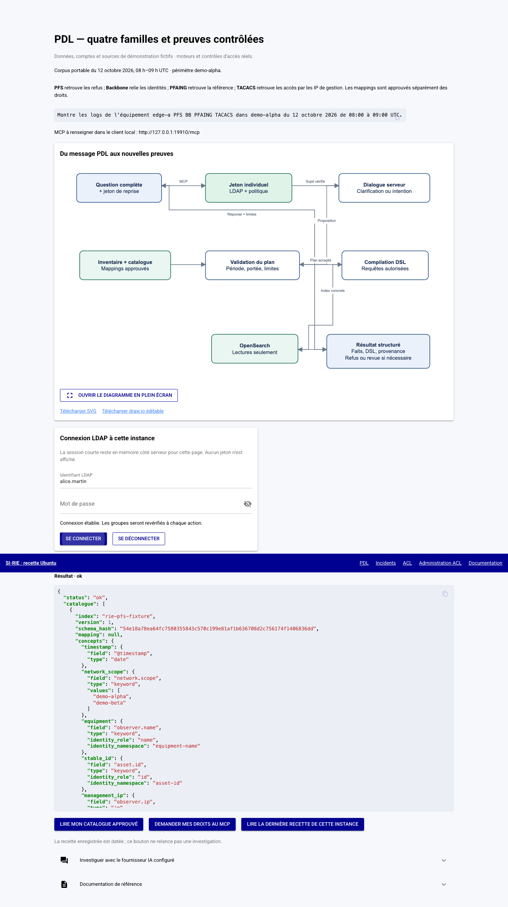

La capture d'administration montre un **blocage volontaire des métriques**
pour tester le refus depuis une session interne existante. Ce droit a ensuite
été rétabli à sa valeur initiale ; la capture ne définit pas une configuration
à recopier. Le [bilan](08-qualification.md) identifie les tests et limites.

## Galerie de qualification du 6 novembre 2026

Ces captures proviennent des essais réels décrits ci-dessous, sur des comptes,
équipements, tickets et données **fictifs**. Elles ont été relues visuellement et
copiées sans retouche. Les formulaires LDAP visibles sont vides de mot de passe ;
aucune clé ni aucun jeton n'est publié. Les horaires sont ceux des fichiers de
capture, en UTC ; ajouter une heure pour Paris à cette date. Les originaux et
reçus restent dans les preuves privées identifiées au bilan. Ces images sont
distinctes des captures historiques de la pile Mac.

### NiceGUI et sources sur Ubuntu 26.04 ARM64 — paquet v5

Chrome est sur le Mac, relié par tunnel au portail de `rie-u26-compat`. Les
cinq captures datent de 15:48 UTC. Le code est celui de
`rie-ubuntu-qualification-v5.tar.gz`, empreinte
`496792903b4c47307f715961ac9210070fd5217da088d5bcd614d27878084ff9`.
Les lecteurs interrogent les véritables services OpenSearch, VictoriaMetrics et
LDAP de la simulation. **Aucune génération IA n'est demandée** dans ces parcours.

**PDL — catalogue courant, 15:48:35 UTC.** L'interne lit les mappings actifs de
son instance sur les quatre familles. Cette vue du catalogue ne représente pas
une nouvelle investigation générée par Albert.

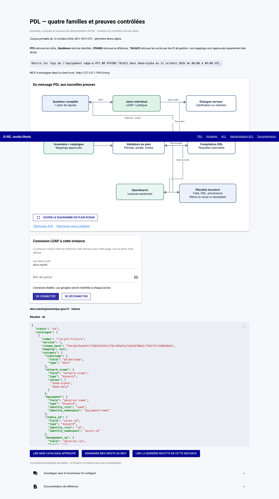

**Incidents — lecture interne, 15:48:39 UTC.** Les sources sont relues pour R1,
sur la fenêtre fictive du 28 septembre 2026, sans synthèse IA. Le résultat
structuré présente la provenance et les calculs.

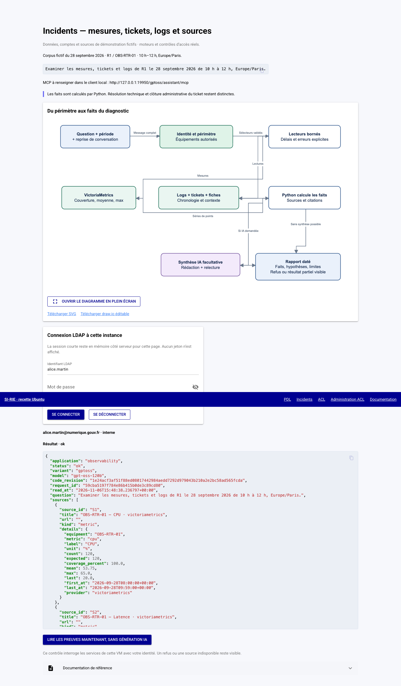

**Incidents — refus externe, 15:48:40 UTC.** La demande est refusée pour
l'identité externe ; les tableaux de preuves du nouveau résultat restent vides.

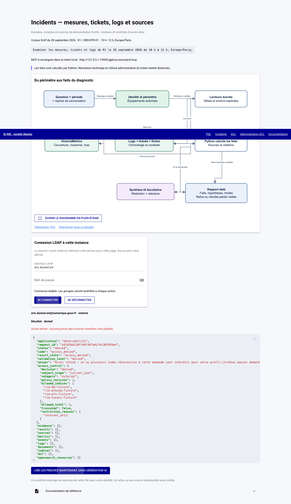

**ACL — droits externes actualisés, 15:48:42 UTC.** Pendant cet essai,
`rie-pfs-fixture` passe temporairement à `internal` : l'externe ne voit plus
que trois index autorisés. Ce test précis modifie PFS ; la démonstration guidée
plus haut peut appliquer la même séquence à TACACS. La règle PFS est rétablie
dans le bloc de nettoyage du test.

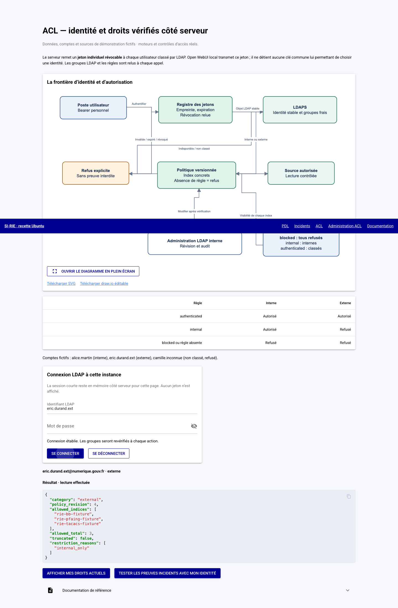

**ACL — administration interne, 15:48:42 UTC.** La règle exacte et sa révision
sont affichées après enregistrement. Le groupe est revérifié avant chaque
modification ; cette vue n'accorde aucun accès à une session externe.

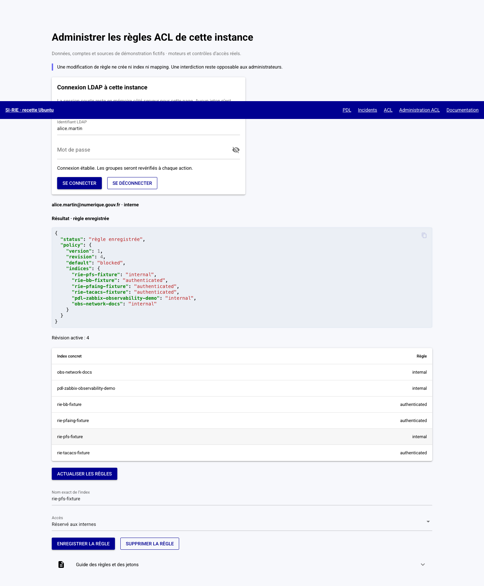

### Open WebUI local sur Mac — Albert réel, backends Ubuntu 24.04 ARM64 v6

Cette autre séance utilise Open WebUI stock `0.11.3-slim`, dans deux clients
Colima locaux isolés, Albert réel `gpt-oss-120b` et les backends de
`rie-u24-manual` déployés avec le **paquet v6**, empreinte
`f898bed5092fd72cd364335df6ed58406c806afea37af7eaaec9e2723bf27b65`.
Le premier parcours de six cas a réussi cinq cas sur six, en sept soumissions.
Le cas externe Incidents a reçu une limitation de cadence sans preuve, puis
Albert a demandé un nouvel appel que la limite de boucle du client a arrêté.
Ce premier parcours reste enregistré comme un **échec**.

L'attente du harnais était comptée depuis le début du diagnostic précédent ;
elle est corrigée pour démarrer après sa réponse. Le seul cas externe a ensuite
été rejoué manuellement dans un nouveau fil, après le délai complet : réussite,
avec un seul appel natif et sans changement du modèle, du backend ou de la
limite de boucle. Le total est de **huit soumissions**, dont cette reprise
distincte ; un nouveau parcours complet du harnais corrigé n'est pas revendiqué.
Les jetons temporaires ont été révoqués, les clients et leur VM Colima arrêtés,
leurs volumes et conversations conservés. Aucun accès au SI-RIE réel n'est revendiqué.

**PDL — deux refus, 16:24:25 UTC.** Le résultat d'un appel MCP réel reprend le
comptage exact, le périmètre et les limites du corpus du 12 octobre.
La preuve du rapprochement sur quatre familles reste dans les reçus privés.

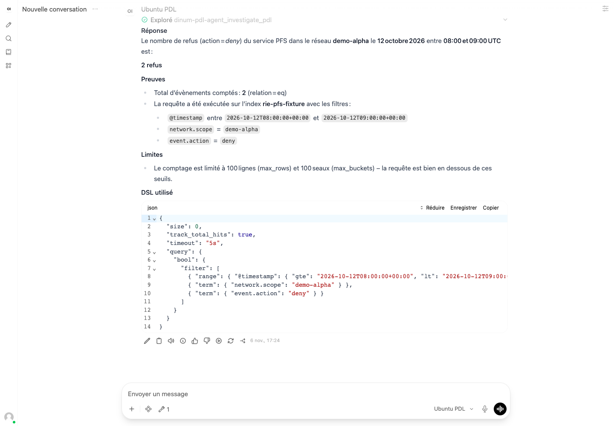

**Incidents — synthèse et citations, 16:26:28 UTC.** La fin du rapport montre
les sources et les limites. Les précédents documentaires apportent du contexte
et ne démontrent pas la cause actuelle. Le reçu technique vérifie séparément
les cinq mesures, les 120 logs et la conservation de la réponse serveur ; ces
vérifications ne sont pas toutes lisibles sur cette seule image.

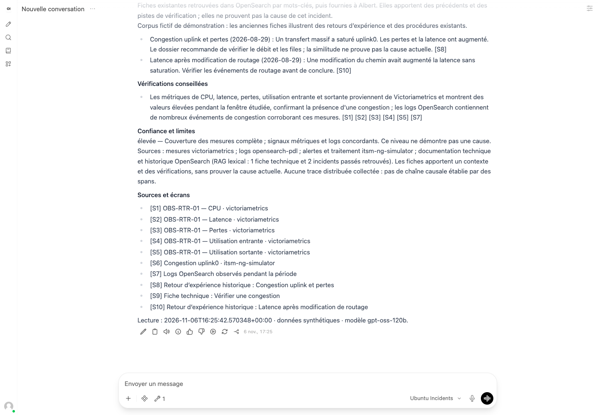

**Incidents — externe refusé lors de la reprise, 16:32:17 UTC.** Cette image
provient uniquement de la reprise manuelle réussie. Le client restitue le refus
du serveur, sans preuve interdite ; elle ne représente pas le premier appel
limité en cadence. Le modèle et le client ne peuvent pas accorder cet accès.

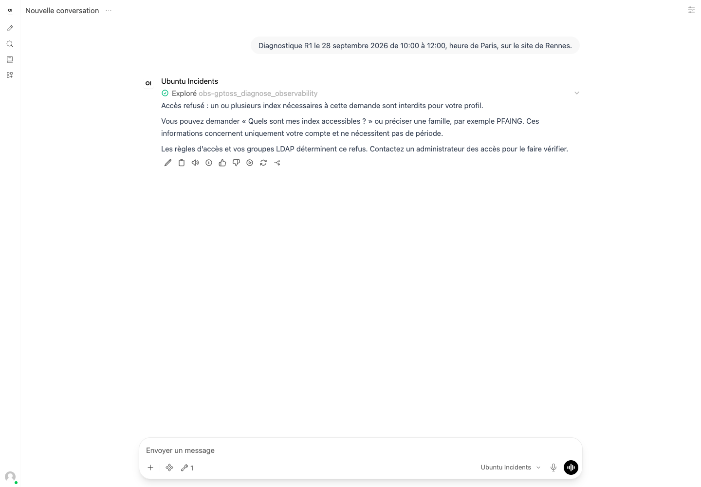

Les résultats figurent dans [Qualification](08-qualification.md). Une capture
ne remplace pas un résultat de test ni un essai de charge ; aucune capacité de
serveur AMD64 ou de SI réel n'est déduite de ces images.

## Galerie des corrections du 7 novembre 2026

Captures de la campagne native Ubuntu 24.04, instance de corrections C1,
données et identités fictives. Le reçu navigateur est daté du 2026-11-07T16:50:36.558095+00:00.
Les dix-huit contrôles incluent aussi Bruno, interne lecteur refusé dans
l'administration et les rapports ; les captures historiques ci-dessus gardent
leurs versions. Aucun appel IA n'a été effectué dans ce parcours.

**PDL :** catalogue des quatre familles sur le moteur portable.

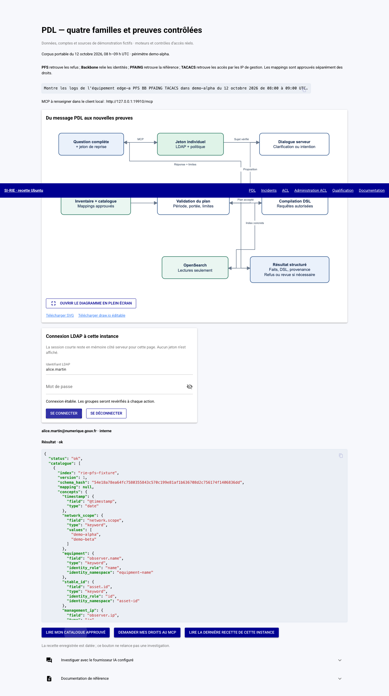

**Incidents :** cinq métriques et logs fraîchement relus, synthèse désactivée.

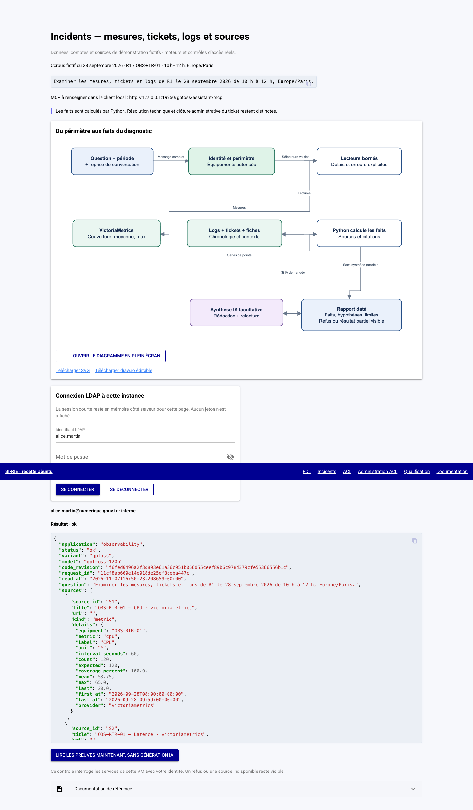

**ACL :** source métrique temporairement interdite par Alice, administratrice
explicite ; la règle a été rétablie par le test après le refus attendu.

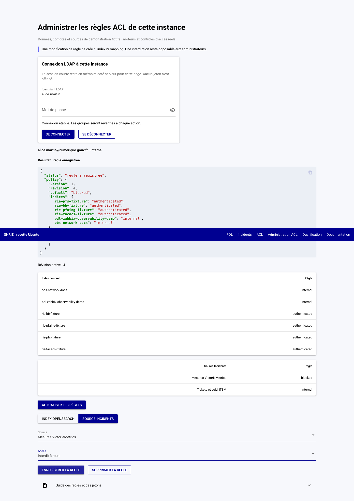

## Captures du 13 novembre 2026 — compatibilité Ubuntu 26.04

Ces captures sans retouche proviennent de la nouvelle instance Ubuntu 26.04.1
ARM64 de la [campagne finale](20-final-ubuntu-qualification.md), avec les services
réellement déployés et le corpus fictif. Les 22 contrôles navigateur passent.
Ils ne demandent pas de génération Albert ; les conversations réelles du
12 novembre ont leur [rapport distinct](19-openwebui-corrections.md).

PDL montre le catalogue approuvé avec l'identité d'Alice, pas une nouvelle
investigation IA. La lecture Incidents du 13 novembre à 15:53 UTC montre les
mesures, la chronologie simulée et les précédents lus dans ITSM-NG natif.
La vue ACL d'Éric est capturée pendant une restriction de test de PFS : les
trois index affichés ne définissent pas une nouvelle politique par défaut.
Les règles sont rétablies à la fin de la recette. Les ports personnalisés
visibles appartiennent à cette instance de compatibilité.

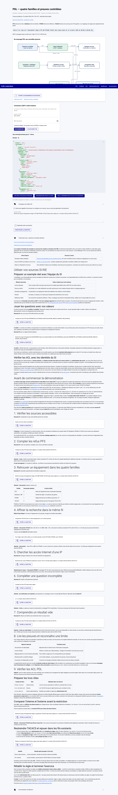

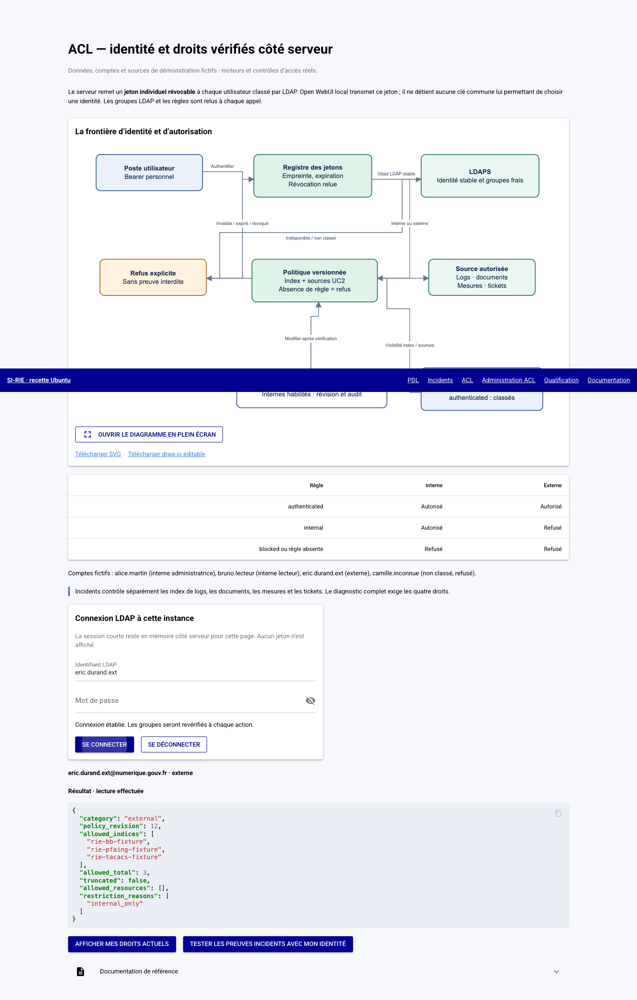

## Captures du 9 novembre 2026

Ces captures proviennent de la VM Ubuntu restaurée, avec le portail corrigé et
les comptes fictifs. Les mots de passe sont effacés avant capture. Elles
complètent les preuves datées des campagnes antérieures.

Le catalogue PDL confirme les quatre familles approuvées ; il ne constitue pas
une nouvelle investigation IA.

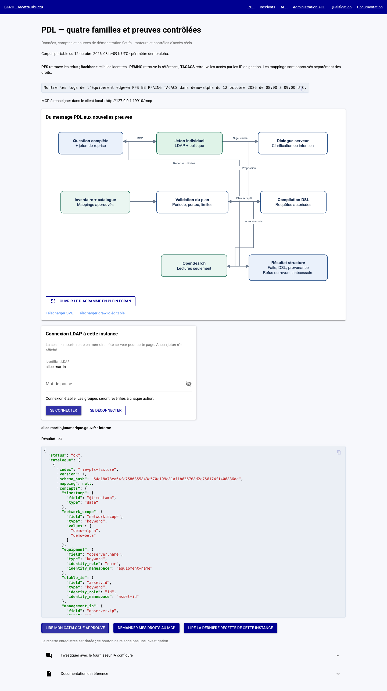

Le diagnostic Incidents ci-dessous lit les sources sans génération IA. Le nom
du modèle indique la configuration et ne prouve pas un appel Albert.

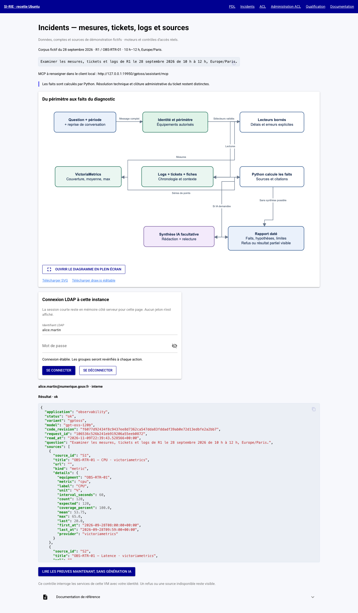

L'externe retrouve ses quatre index PDL et aucune ressource Incidents.

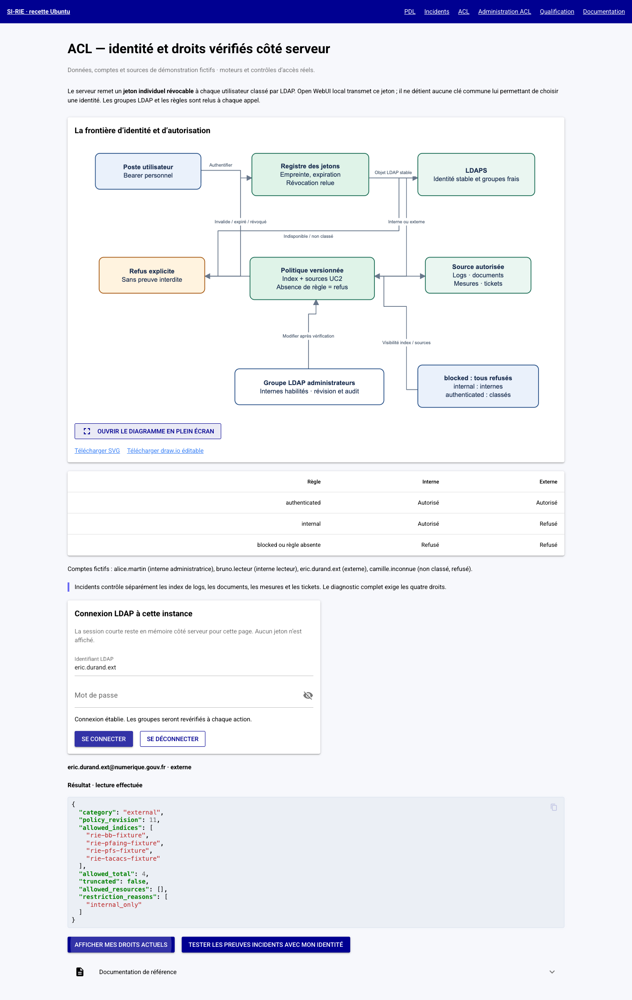
