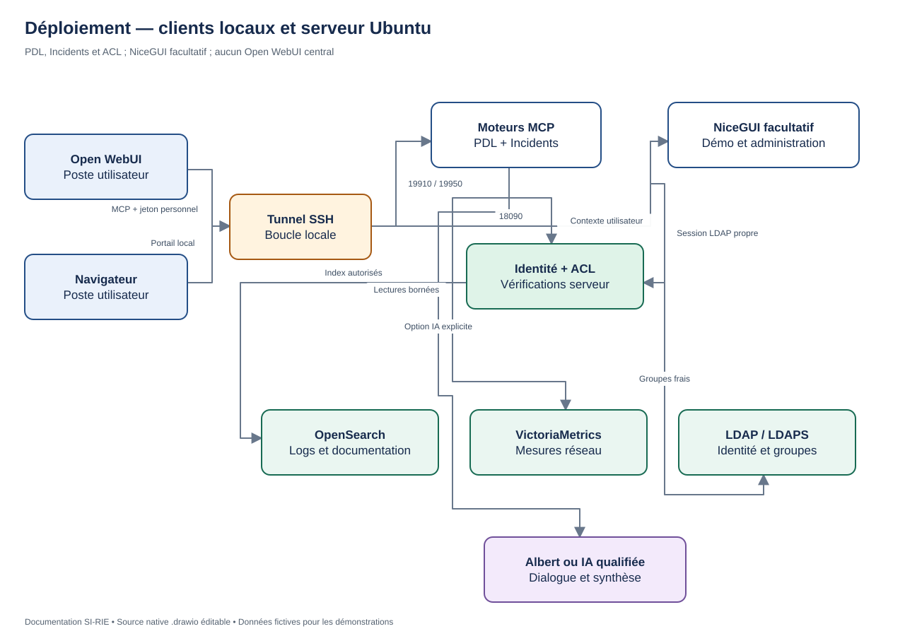

# PDL, Incidents et ACL — documentation SI-RIE

Ce dossier accompagne la livraison des deux cas d'usage DINUM. Il permet à un
installateur de déployer, à un exploitant de reprendre les services et à un
développeur de retrouver les contrôles qui produisent une réponse.

Le serveur Ubuntu héberge les moteurs et les droits. **Open WebUI est installé
sur chaque poste utilisateur.** Le portail NiceGUI est une option de démonstration,
d'administration et de consultation des rapports de qualification, pas un serveur
Open WebUI central.

## Déployer dans le SI-RIE

**Point d’entrée unique : [Déployer PDL, Incidents et les ACL, pas à pas](24-deploy-walkthrough.md).**
Ce déroulé comporte douze étapes, avec les commandes, la machine concernée et
le résultat attendu. L'archive source y renvoie depuis son `README.md`.
Les pages de ce catalogue sont des références ; il ne faut pas exécuter un autre
parcours en parallèle.

Faire remplir la **[fiche de raccordement SI-RIE](26-si-connection-sheet.md)**
par les responsables avant l'installation. Le guide utilise les images
approuvées de la registry GitLab, le mode `external`, les véritables comptes
LDAP et les cas métier du SI. Open WebUI reste sur le poste utilisateur.

Pour répéter le même parcours sur **un Ubuntu dont les sources simulées ont été
préparées séparément**, la [fiche sandbox](22-external-sandbox.md) conserve
les paramètres, accès locaux et résultats fictifs du 16 novembre. Le
[manuel général](01-installation.md) documente les autres choix d’installation ;
il ne remplace pas le déroulé retenu pour cette séance.

### Fiche de raccordement

La **fiche de raccordement** est le document de paramètres fourni au déployeur
par les responsables des services du SI. Elle indique **où joindre les services
et avec quels accès le PoC peut les lire** : adresses, ports, certificats,
comptes lecteurs, groupes LDAP, index et formats des données. Le déployeur
reporte ces valeurs dans `.env` et dans les fichiers de configuration du PoC.
Par exemple, l'adresse du cluster OpenSearch devient `OPENSEARCH_URL`.

Dans cette sandbox, la [fiche lisible](22-external-sandbox.md#fiche-de-raccordement-de-cet-exercice)
est accompagnée de `$HOME/si-connection/connection.json`, qui reprend les
paramètres sans secret. Les mots de passe et jetons sont remis dans les fichiers
privés référencés sous `$HOME/si-connection/private`. Dans le SI-RIE réel, les
responsables des sources devront fournir ou confirmer ces informations.

Le [glossaire du déploiement](23-glossary.md) définit également les termes
instance, sandbox, mapping, ACL, jeton, CA, MCP et recette.

### Valeurs à adapter au SI réel

**En production, `RIE_ADMIN_LDAP` doit désigner un compte existant dans le
LDAP cible, habilité à administrer les accès du PoC.** `alice.martin` est
l'identité fictive fournie pour cet exercice. Le compte réel doit être classé
interne et appartenir directement à un groupe déclaré dans
`ldap.administrator_group_dns` ; voir les [droits requis](06-acl.md#séparer-lecteur-interne-et-administrateur).
Il s'agit du rôle d'administrateur des accès du PoC, sans nécessité d'être
administrateur technique de l'annuaire LDAP. Le compte SSH Ubuntu et le compte
LDAP lecteur de service remplissent d'autres rôles.

Le déployeur adapte **les valeurs des commandes et les fichiers privés de
l'instance**, à partir de la fiche de raccordement. Le README sert de guide.

| Élément du parcours | À fournir ou confirmer pour le SI réel |
| --- | --- |
| `INSTALLER_USERNAME`, `SSH_USERNAME`, `UBUNTU_SERVER` | Comptes Unix/SSH, serveur cible et droits système attribués au déployeur et aux utilisateurs |
| `RIE_ARCHIVE` / version Git | Nom exact du paquet reçu ou commit complet de la version fournie ; les dates de la sandbox ne désignent pas une version de production |
| `RIE_SOURCES`, `RIE_INSTANCE` | Dossiers autorisés, distincts, adaptés au compte Ubuntu ; extraction neuve et instance hors des sources |
| `RIE_MODE` | Conserver `external` pour raccorder les services existants ; cette valeur convient à la sandbox préparée et au SI réel |
| `RIE_ADMIN_LDAP` et les comptes utilisateurs | Identifiants existant dans le LDAP cible, groupes et habilitations confirmés ; chaque utilisateur autorise personnellement ses sources depuis Open WebUI |
| Configuration LDAP | Serveur, port LDAPS, CA, compte lecteur et secret, base de recherche, attributs et DN réels des groupes |
| Sources OpenSearch | URL, CA, compte lecteur et secret, noms réels des index PDL/Incidents, champs et mappings à faire approuver |
| Mesures et inventaire Incidents | URL VictoriaMetrics, authentification, séries, labels, unités, équipements et périmètres disponibles |
| Tickets et précédents ITSM-NG | Version/API confirmées, URL et CA, export courant autorisé, App-Token si nécessaire et credentials ITSM propres à chaque utilisateur |
| Fournisseur IA | URL Albert ou fournisseur autorisé, clé privée, modèles disponibles et qualifiés, CA/proxy et quotas applicables |
| Questions et recette métier | Équipements, périodes, fuseaux et résultats de référence fournis par le métier ; `edge-a`, `OBS-RTR-01` et les dates des tutoriels sont fictifs |
| Poste utilisateur et ports | Open WebUI local, ports/tunnels et URL MCP adaptés à son mode d'installation ; NiceGUI reste facultatif |

Les fichiers sous `$HOME/si-connection` et les valeurs `172.17.0.1`, `demo-alpha`
ou `rie-*-fixture` appartiennent à notre sandbox. Pour le SI réel, leurs
équivalents viennent des responsables des services. La
[configuration détaillée](02-configuration.md) indique les destinations et la
[matrice de réception](14-si-rie-acceptance.md) les vérifications restantes.
Pour les précédents, la [fiche de raccordement ITSM](15-itsm-precedents.md#fiche-de-raccordement-itsm-à-faire-compléter)
précise ce que le responsable du service doit remettre et ce que le déployeur
doit vérifier. Un état `ready` confirme les sondes de disponibilité avec le
compte choisi ; la réception inclut aussi des données connues et des refus
comparés aux outils natifs du SI.

### Lire les métadonnées du paquet

Après l'étape de vérification, `source.dirty` décrit **le dépôt Git du
préparateur au moment de fabriquer l'archive**. `true` signifie qu'il contenait
des modifications non enregistrées dans un commit ou des fichiers non suivis.
Pour notre paquet de recette, les renommages et la documentation sont encore
en cours de finalisation. Le manifeste décrit les octets exacts livrés ; ce
statut Git ne signifie pas que l'archive reçue est corrompue.

`authenticity: not_verified_by_checksum` signifie que cet outil vérifie
l'intégrité des fichiers, **sans vérifier l'identité de l'éditeur par une
signature**. L'origine du paquet se confirme par le canal de distribution
approuvé et une référence d'empreinte indépendante ou une signature vérifiée.
Voir l'[explication complète des résultats](01-installation.md#interpréter-le-résultat-de-vérification-du-paquet).

### Choisir le mode ou retrouver celui d'une instance

**Le mode appartient à une instance du PoC, pas à la machine.** Avant sa
préparation, il n'y a pas encore de mode enregistré : l'installateur le choisit
selon les sources à utiliser.

| Mode | Sources de données et annuaire | Quand le choisir |
| --- | --- | --- |
| `demo` | Le déploiement crée OpenSearch, VictoriaMetrics et LDAP avec le corpus et les comptes fictifs | Démonstration autonome qui installe aussi ses sources |
| `external` | Le PoC se raccorde à des services déjà disponibles, sans les créer ni les initialiser | SI-RIE réel, ou sandbox dont les sources simulées ont été préparées séparément |

Pour la répétition sur le SI simulé déjà préparé, choisir `external` **dans le terminal
Ubuntu** ; la préparation commune précisera ensuite le dossier d'instance :

```bash
# Choisit external : le PoC utilisera les services SI déjà disponibles, sans les recréer.
export RIE_MODE=external
# Affiche le mode choisi dans ce terminal ; ne prépare ni ne transforme une instance.
printf 'Mode choisi pour la préparation : %s\n' "$RIE_MODE"
```

**Attendu :** `Mode choisi pour la préparation : external`. Cette variable décrit
le choix pour les commandes suivantes ; elle ne transforme pas une instance
existante. Les variables doivent être redéfinies dans une nouvelle session.

**Pour une instance déjà préparée**, après avoir défini `RIE_INSTANCE` avec
son dossier réel, lire uniquement le mode enregistré :

```bash
# Lit uniquement le mode enregistré de l'instance existante, sans afficher les autres paramètres privés.
sudo grep '^RIE_MODE=' "$RIE_INSTANCE/.env"
```

**Attendu :** exactement `RIE_MODE=demo` ou `RIE_MODE=external`. Un fichier
introuvable impose de vérifier le chemin et si la préparation a déjà eu lieu ;
cela ne désigne aucun mode par défaut. Pour changer de mode, préparer une autre
instance. Le choix d'Albert est indépendant : les deux modes peuvent utiliser
l'API réelle. Open WebUI reste sur le poste utilisateur dans les deux cas.

### Suivre les étapes de la sandbox

Suivre uniquement le [déroulé continu, étapes 1 à 12](24-deploy-walkthrough.md).
Les numéros sont les mêmes dans le guide du dépôt et le README d’accueil sur
Ubuntu. **Après vérification/extraction du paquet et définition de
`RIE_INSTANCE`, `RIE_MODE`, `RIE_ADMIN_LDAP`, les étapes 1 à 3 sont terminées :
reprendre à l’[étape 4, prérequis](24-deploy-walkthrough.md#4-vérifier-les-prérequis).**
Ne pas réextraire le paquet ou préparer à nouveau une instance déjà créée.

## Commencer par le déroulé de déploiement

Le **[guide pas à pas du SI-RIE](24-deploy-walkthrough.md)** rassemble les
commandes nécessaires dans leur ordre d’exécution, jusqu’aux conversations
Albert et à la reprise. Le [manuel général](01-installation.md) reste la
référence pour les installations scriptées et le mode `demo`.
La [fiche de raccordement](26-si-connection-sheet.md) attribue les paramètres
à fournir avant installation. La [matrice SI-RIE](14-si-rie-acceptance.md) précise les paramètres
et validations à obtenir pour le raccordement réel.

| Besoin | Page à lire |
| --- | --- |
| Déployer dans le SI-RIE de bout en bout | **[Déroulé unique, étapes 1 à 12](24-deploy-walkthrough.md)** |
| Faire fournir les paramètres et attribuer les prérequis | [Fiche de raccordement SI-RIE](26-si-connection-sheet.md) |
| Retrouver les variantes et prérequis généraux | [Manuel de référence](01-installation.md) |
| Répéter l'installation seule du PoC avec un SI simulé déjà disponible | [Sandbox externe et fiche de raccordement](22-external-sandbox.md) |
| Comprendre le vocabulaire de l'installation et de l'exploitation | [Glossaire du déploiement](23-glossary.md) |
| Préparer les paramètres, secrets et sources | [Configuration](02-configuration.md) |
| Comprendre les composants et les flux | [Architecture](03-architecture.md) |
| Maintenir les recherches et mappings PDL | [Technique PDL](04-pdl.md) |
| Comprendre le diagnostic réseau | [Technique Incidents](05-incidents.md) |
| Raccorder les précédents ITSM-NG 1.6.17 et valider les quatre US | [Précédents et solution proposée](15-itsm-precedents.md) |
| Donner, retirer et expliquer les droits | [ACL et identités](06-acl.md) |
| Connecter Open WebUI sans copier de jeton MCP | [Connexion individuelle LDAP et OAuth](25-user-access.md) |
| Arrêter, restaurer et dépanner | [Exploitation](07-operations.md) |
| Lire les résultats et leurs limites | [Qualification](08-qualification.md) |
| Examiner la nouvelle installation, la CI et la reprise sur Ubuntu | [Remise du 13 novembre](20-final-ubuntu-qualification.md) |
| Suivre la capture continue et l'import du véritable rapport CI | [Clôture des réserves de preuve](21-evidence-reservations.md) |
| Identifier tout ce qui reste à réceptionner dans le SI réel | [Prérequis, écarts et recette SI-RIE](14-si-rie-acceptance.md) |
| Ouvrir les campagnes Allure depuis NiceGUI ou remettre un rapport CI | [Rapports de tests](13-test-reports.md) |
| Examiner la campagne initiale et ses défauts, conservés comme référence | [Stabilité Open WebUI : bilan initial](18-openwebui-stability.md) |
| Suivre les corrections, leurs non-régressions par lot et la nouvelle recette Albert | [Corrections Open WebUI](19-openwebui-corrections.md) |
| Utiliser le PoC avec les comptes et sources de votre SI | [PDL : préparer vos questions](16-pdl-tutorial.md#utiliser-vos-sources-si-rie) · [Incidents : préparer votre diagnostic](17-incidents-tutorial.md#utiliser-vos-sources-si-rie) |
| Apprendre sur le corpus fictif fourni en mode `demo` | [Tutoriel PDL](16-pdl-tutorial.md#avant-de-commencer-la-démonstration) · [Tutoriel Incidents](17-incidents-tutorial.md#avant-de-commencer-la-démonstration) |
| Choisir le parcours ou présenter les démonstrations | [Prise en main et démonstrations](09-demonstrations.md) |
| Exporter les pages et diagrammes | [Import Wiki.js et maintenance](10-wikijs.md) |
| Comprendre les reprises de l'installation native | [Journal d'installation](11-installation-log.md) |
| Consigner la validation par un humain | [Fiche de recette manuelle](12-manual-acceptance.md) |



[Ouvrir le diagramme éditable draw.io](diagrams/01-deployment.drawio) ·
[Télécharger son image PNG](assets/diagrams/01-deployment.png)

## Reconnaître le périmètre livré

La recette de référence repose sur Ubuntu 24.04 LTS ARM64, avec contrôle de
compatibilité Ubuntu 26.04 LTS. Les performances d'une VM sur le MacBook ne
constituent pas un dimensionnement du serveur SI-RIE.

Le runtime PDL/Incidents et l’opérateur utilisent une image commune minimale.
NiceGUI utilise une image facultative dérivée, avec ses dépendances et documents.
La qualification de charge et de pannes constitue une troisième cible explicite.
Le paquet opérateur ne contient pas un workflow CI isolé : le dépôt complet
porte la publication GitHub et les suites de développement.

Le mode `demo` crée de vrais services OpenSearch, VictoriaMetrics et LDAP,
alimentés par des données fictives versionnées. Les alertes et tickets courants
utilisent un snapshot simulé. Le connecteur de précédents peut être raccordé
à ITSM-NG 1.6.17 ; le laboratoire le vérifie sur un vrai serveur avec tickets
et identités fictifs, provisionné séparément.
Le mode `external` raccorde les sources configurées par leurs responsables ;
il n'initialise aucune donnée dans le SI réel. Un modèle IA interne ou Albert
nécessite sa propre recette de génération.

La campagne conversationnelle initiale du 11 novembre conserve ses défauts :
50 messages conformes sur 96, aucun fil de dix tours entièrement conforme.
Les [preuves initiales](18-openwebui-stability.md) et les
[corrections vérifiées le 12 novembre](19-openwebui-corrections.md) restent
consultables séparément. L'intégration SI-RIE reste à réceptionner.
La [matrice de raccordement](14-si-rie-acceptance.md) distingue
les écarts connus, les prérequis à fournir, les essais non faits et leurs
responsables. Un processus `ready` ne suffit pas à déclarer l'ensemble accepté.

Le déploiement de l'observabilité, les autres PoC et les essais Dify/n8n sont
hors de ce dossier. Le mot `observability` présent dans quelques chemins de
code désigne le moteur historique Incidents.

## Lire une preuve de validation

La [recette conversationnelle corrigée du 12 novembre](19-openwebui-corrections.md) termine avec **96 / 96 échanges conformes sur trois répétitions**, et 1 279 non-régressions réussies. Elle porte sur Ubuntu 24.04 ARM64 et des données fictives. La [remise du 13 novembre](20-final-ubuntu-qualification.md) complète ces preuves par une installation neuve, les essais d'exploitation et de compatibilité 26.04. Le [bilan du 14 novembre](21-evidence-reservations.md) confirme l'import du véritable rapport CI et la capture continue de deux heures : **8 460 demandes sans erreur métier**. Il conserve l'échec du collecteur de stockage, son correctif et sa validation séparée. La [réception du SI réel](14-si-rie-acceptance.md) reste à effectuer.

Une preuve doit identifier la version, la machine, le scénario, son résultat et
le fournisseur IA réellement utilisé. Un processus HTTP sain ne prouve ni que
les sources sont disponibles, ni qu'un utilisateur est autorisé, ni qu'Albert
produit une réponse correcte. La [page de qualification](08-qualification.md)
sépare ces niveaux et les validations encore nécessaires.
Les [rapports de tests](13-test-reports.md) détaillent les cas exécutés ;
NiceGUI fournit leur catalogue et l'accès aux rapports Allure importés.

Ce dossier peut être lu directement dans le dépôt, dans NiceGUI ou après
export vers Wiki.js. Les textes et figures restent les mêmes dans ces trois
parcours. Les diagrammes natifs se trouvent dans `diagrams/` ; les SVG/PNG
permettent leur lecture sans service de rendu externe.
