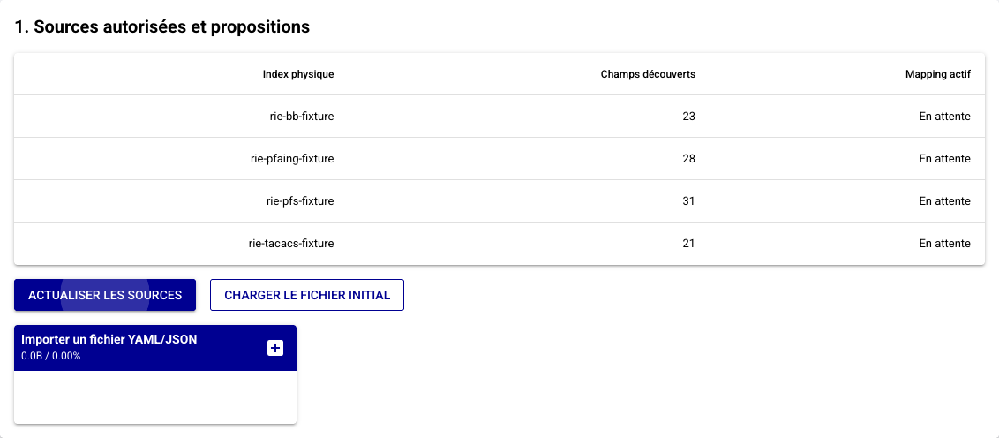
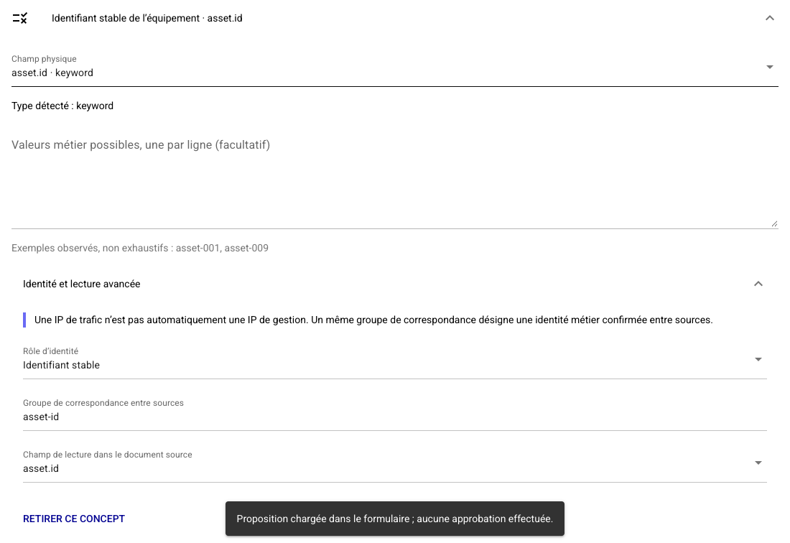
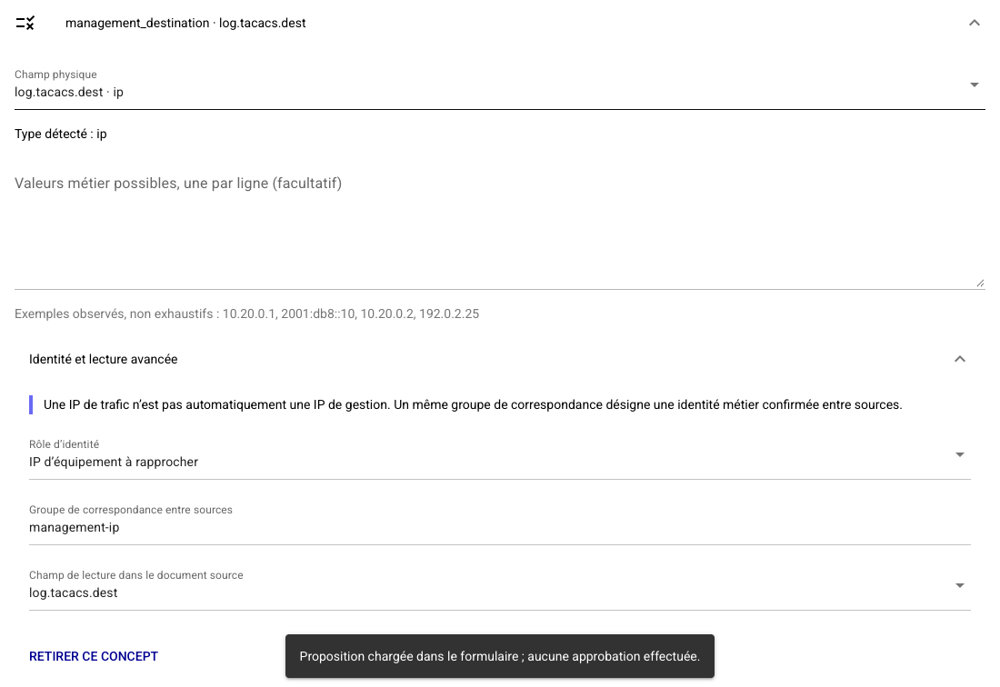
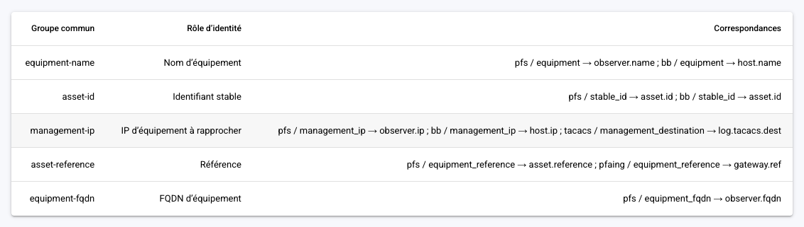
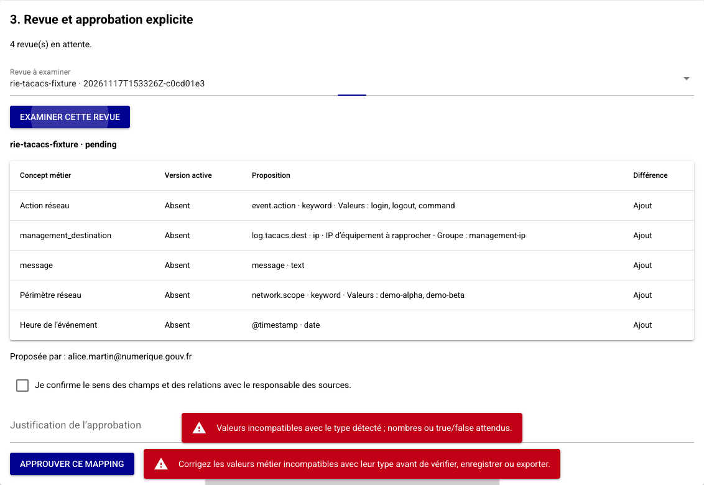
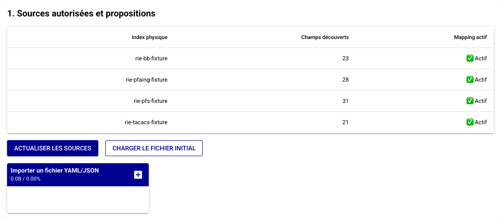
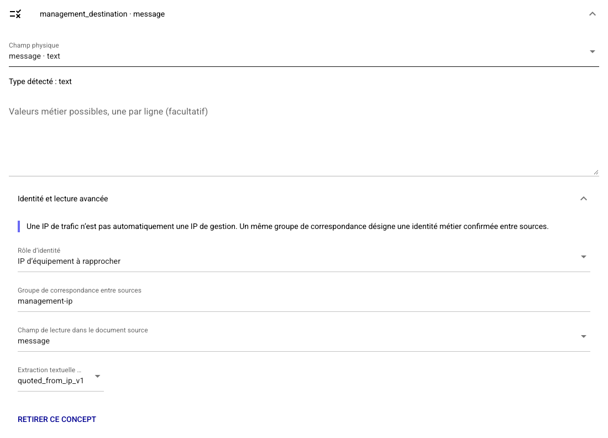
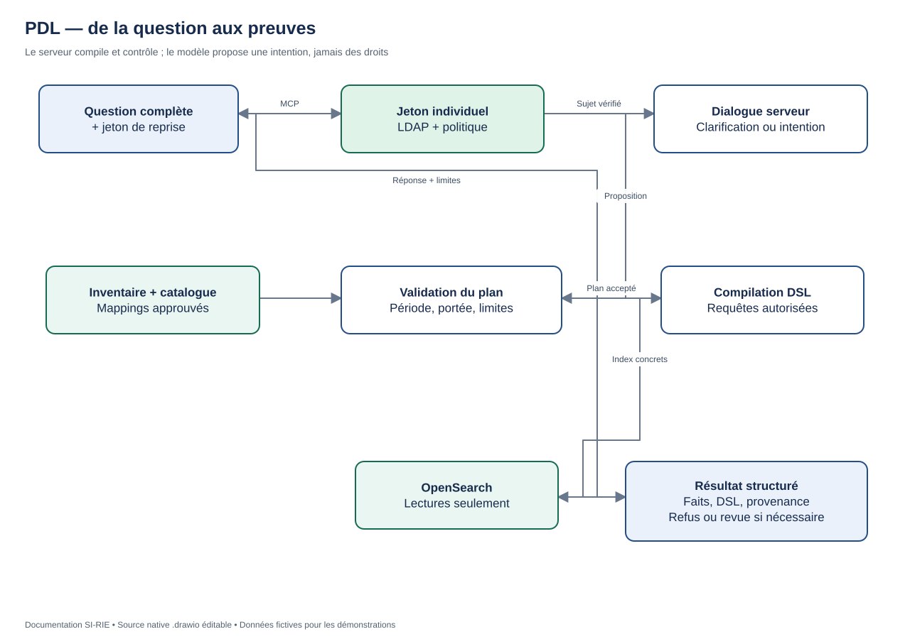

# Technique PDL : de la question aux preuves

> Complément de référence — le [guide principal](../README.md) reste le seul parcours de déploiement à exécuter.

## Exemple complet illustré : des champs PDL aux accès TACACS

Cet exemple accompagne le formulaire **Mappings PDL** de NiceGUI
(`/admin-mappings`). Il est placé dans le bloc **« Exemple complet illustré ·
PFS, Backbone, PFAING et TACACS »**, fermé par défaut, avant la connexion.
Le consulter n’importe aucun fichier et ne change aucun mapping.

**Cadre des captures : 17 novembre 2026, Ubuntu 24.04 ARM64, instance de
qualification autonome**, avec son propre LDAP, OpenSearch et catalogue.
Les comptes, adresses, noms et événements sont fictifs. Les validations et
approbations visibles sont réelles dans cette instance ; elles ne valent pas
approbation du SI-RIE. Le mapping est une configuration déterministe : sa
préparation ne demande aucune génération IA. Les conversations métier avec
Albert se valident séparément à l’[étape 11](../README.md#11-jouer-les-deux-uc-et-leurs-acl-avec-albert).

### 1. Partir d’une question et des preuves attendues

Nous voulons retrouver les événements de **`edge-a`**, dans **`demo-alpha`**,
le **12 octobre 2026 de 08:00 à 09:00 UTC** — soit de **10:00 à 11:00 à Paris**.
Une même machine apparaît sous plusieurs identifiants selon les sources :

| Famille | Informations présentes dans les documents fictifs utiles |
| --- | --- |
| PFS | `observer.name = edge-a`, `asset.id = asset-001`, `observer.ip = 10.20.0.1`, `asset.reference = gateway-73` |
| Backbone | `host.name = edge-a`, même ID `asset-001`, tableau `host.ip = [10.20.0.1, 2001:db8::10]` |
| PFAING | `gateway.ref = gateway-73` ; ni le nom `edge-a`, ni son ID ne sont nécessaires dans cet événement |
| TACACS | `log.tacacs.dest = 10.20.0.1` ou `2001:db8::10` ; ni nom d’équipement, ni ID stable dans ces événements |

Le chemin à faire confirmer est donc : **nom → ID stable → IP de gestion →
événements TACACS**, et **nom → ID stable → référence → événements PFAING**.
Les relations ne sont pas déduites du nom des champs ou de valeurs identiques.
Le responsable des sources confirme ce qu’identifient réellement ces champs.

### 2. Découvrir les sources et charger une proposition

1. Se connecter au formulaire avec un **vrai compte LDAP administrateur** du SI.
   Alice est le compte fictif du laboratoire, pas une valeur à reprendre en production.
2. Cliquer sur **« Actualiser les sources »**. Les index autorisés et le nombre
   de champs découverts apparaissent ; cette lecture n’approuve rien.
3. Si le responsable du SI a fourni un fichier, cliquer sur **« Charger le
   fichier initial »** pour `config/mappings.yaml`, ou utiliser **« Importer un
   fichier YAML/JSON »**. Sinon, choisir **« Ajouter un index découvert »**,
   puis **« Ajouter cet index »**, et ajouter les concepts ci-dessous.
4. Le champ **« Profil à modifier »** permet de passer d’une source à l’autre.
   Les noms `pfs`, `bb`, `pfaing` et `tacacs` de l’exemple sont des profils du
   fichier ; ils ne donnent aucun droit d’accès.



*Les quatre sources de départ sont visibles. « En attente » dans la colonne
Mapping actif signifie qu’il manque une approbation ; ce n’est pas un défaut
OpenSearch. Les quatre revues ne seront créées qu’à l’étape 6 de cet exemple.*

### 3. Renseigner les concepts, types et valeurs

Dans chaque profil, ouvrir un concept, sélectionner **« Champ physique »**,
puis contrôler **« Type détecté »**. Ajouter les concepts manquants avec
**« Ajouter un concept métier »**. Pour une création manuelle du profil TACACS,
le concept proposé **« IP de gestion »** (`management_ip`) convient aussi :
il doit utiliser le même champ, rôle et groupe que `management_destination`
dans le fichier fourni. Les noms des concepts sont distincts des champs physiques.

| Concept | PFS | Backbone | PFAING | TACACS structuré |
| --- | --- | --- | --- | --- |
| `timestamp` — heure de l’événement | `@timestamp` · `date` | identique | identique | identique |
| `network_scope` — périmètre | `network.scope` · `keyword` | identique | identique | identique |
| `equipment` — nom | `observer.name` · `keyword` | `host.name` · `keyword` | `observer.hostname` · `keyword`, sans rôle d’identité dans ce corpus | absent |
| `stable_id` — identifiant stable | `asset.id` · `keyword` | `asset.id` · `keyword` | absent | absent |
| `management_ip` — IP de gestion | `observer.ip` · `ip` | `host.ip` · `ip`, parfois plusieurs valeurs | absent | voir `management_destination` |
| `equipment_reference` — référence | `asset.reference` · `keyword` | absent | `gateway.ref` · `keyword` | absent |
| `equipment_fqdn` — nom DNS complet | `observer.fqdn` · `keyword` | absent | absent | absent |
| `source_ip` — IP du trafic source | `source.ip` · `ip` | absent | `client.ip` · `ip` | absent |
| `destination_ip` — IP du trafic destination | `destination.ip` · `ip` | absent | `server.ip` · `ip` | absent |
| `action` — action réseau | `event.action` · `keyword` | absent | `event.action` · `keyword` | `event.action` · `keyword` |
| `management_destination` — équipement cible TACACS | absent | absent | absent | `log.tacacs.dest` · `ip` |

Les autres concepts de l’exemple complet — domaine virtuel, règle, gravité,
domaine web, URL et message — sont conservés dans le YAML de fin d’exemple.
L’import permet de conserver les concepts personnalisés, y compris ceux dont
le nom anglais n’a pas de libellé particulier dans le formulaire.

Dans **« Valeurs métier possibles, une par ligne »**, saisir uniquement les
valeurs confirmées, en respectant leur casse :

| Concept / profil | Valeurs de cet exemple |
| --- | --- |
| `network_scope` / tous | `demo-alpha`, puis `demo-beta` sur une autre ligne |
| `action` / PFS et PFAING | `deny`, puis `allow` |
| `action` / TACACS | `login`, `logout`, `command` |

Une valeur absente des quelques exemples observés n’est pas forcément impossible.
Ces listes ne traduisent pas automatiquement `deny` en une autre valeur du SI.
Le champ doit porter l’heure de l’événement, pas une date d’ingestion choisie
par commodité. Les fuseaux et valeurs réelles sont à confirmer avec le métier.

### 4. Déclarer l’identité stable et les relations entre sources

Ouvrir **« Identité et lecture avancée »** pour chaque concept d’identité.
Renseigner le rôle et exactement le même **« Groupe de correspondance entre
sources »** pour les informations de même sens :

| Groupe à saisir | Membres de l’exemple | Rôle dans le formulaire |
| --- | --- | --- |
| `equipment-name` | PFS `equipment` et BB `equipment` | Nom d’équipement |
| `asset-id` | PFS `stable_id` et BB `stable_id` | Identifiant stable |
| `management-ip` | PFS `management_ip`, BB `management_ip`, TACACS `management_destination` | IP d’équipement à rapprocher |
| `asset-reference` | PFS `equipment_reference`, PFAING `equipment_reference` | Référence |
| `equipment-fqdn` | PFS `equipment_fqdn` | FQDN d’équipement |

**`asset-id` est l’unique groupe d’ancre** : le rôle `id` suffit ici.
Ne pas cocher en plus le nom comme ancre. Une ancre stable relie les documents
PFS et BB, puis permet de réunir leurs identifiants sans confondre deux machines.
Le FQDN reste dans un groupe distinct du nom court.



*Sur PFS, `stable_id` lit `asset.id`, de type `keyword`, avec le rôle
Identifiant stable et le groupe `asset-id`. Le profil BB utilise le même groupe.*



*Le concept personnalisé `management_destination` lit `log.tacacs.dest`, de type
`ip`. Son rôle est IP d’équipement à rapprocher et son groupe `management-ip`.
Une IPv6 n’exige pas de second concept : le type `ip` et la normalisation du
moteur couvrent IPv4 et IPv6. Le tableau BB n’est pas une chaîne à découper.*

**Ne pas ajouter** `source.ip`, `destination.ip`, `client.ip` ou `server.ip`
à `management-ip` au seul motif qu’ils ont le type `ip`. Dans ce corpus, ce
sont des adresses de trafic. Les y ajouter ferait entrer des événements leurres.
Dans **« Rapprochements prévus entre sources »**, vérifier les membres avant
la validation : un groupe cohérent n’associe pas des rôles différents.



### 5. Vérifier et corriger avant toute approbation

Cliquer sur **« Vérifier la proposition »**. Le résultat attendu est
**« Proposition valide techniquement »**. Cette vérification confronte les
champs, types, dates et relations à l’inventaire ; elle ne confirme pas leur
signification métier et ne rend pas le mapping actif.


*Erreur volontaire du laboratoire : une chaîne dans le concept de gravité BB,
qui attend un nombre. Le formulaire bloque la vérification et aucune revue
n’est créée. Corriger ou vider la valeur fautive, puis vérifier de nouveau.*

| Problème | Correction / contrôle à réaliser |
| --- | --- |
| Champ absent ou mauvais type | Actualiser ; sélectionner le vrai champ du bon profil. Un autre champ de même type peut malgré tout porter un sens erroné. |
| Valeur incompatible | Respecter le type : nombre pour `long`, `true` / `false` pour un booléen ; pas un libellé arbitraire. |
| Identité incohérente | Vérifier rôles, groupes et ancre commune. Ne pas fusionner nom, IP et référence dans un groupe unique. |
| Schéma changé entre deux actions | Actualiser, vérifier de nouveau et examiner la nouvelle revue. L’ancienne décision ne se réutilise pas automatiquement. |
| Index non visible ou refusé | Faire vérifier les droits LDAP/ACL et les motifs de découverte. Le mapping n’accorde aucun accès. |

**« Exporter le YAML »** télécharge la proposition courante. Cela ne l’approuve
pas et ne réécrit pas automatiquement le fichier initial côté serveur.
Conserver l’export approuvé dans le dossier de configuration géré par l’équipe,
selon sa procédure de mise à jour ; le catalogue reste la référence d’exécution.

### 6. Examiner les différences et approuver chaque index

1. Renseigner **« Motif de la proposition »**, puis cliquer sur **« Enregistrer
   une proposition »**. Une première proposition pour les quatre index crée
   **quatre revues en attente**, sans activation.
2. Choisir une entrée dans **« Revue à examiner »**, puis **« Examiner cette
   revue »**. Contrôler le vrai nom d’index, les champs et les différences.
3. Pour TACACS, retrouver le champ `log.tacacs.dest`, le rôle IP et le groupe
   `management-ip`. Si le tableau montre une adresse cliente ou un mauvais rôle,
   corriger la proposition et la faire vérifier de nouveau.
4. Après confirmation par le responsable des sources, cocher **« Je confirme
   le sens des champs et des relations avec le responsable des sources »**,
   renseigner **« Justification de l’approbation »**, puis **« Approuver ce mapping »**.
5. Recommencer pour les autres index. Une approbation concerne **un index
   physique**, pas toute une famille, un joker ou la totalité du fichier.





*Les quatre lignes sont actives et il ne reste aucune revue en attente pour
ce premier parcours. Le bouton de vérification seul n’aurait pas produit cet état.*

### 7. Cas avancé et limite actuelle : TACACS ne fournit qu’un message texte

**Pour publier des logs TACACS, fournir un champ `ip` structuré à
l’ingestion. Le parcours où le texte est le seul lien d’identité de la source
cible n’est pas pris en charge actuellement.** Le test réel de cet exemple
retourne `incomplete`, sans logs publiés : « Aucune relation d’identité
compatible avec l’index rie-tacacs-raw-fixture ».

L’option visible dans le formulaire sert une compatibilité textuelle temporaire
pour la résolution d’identité, sur un format précis, par exemple :

```text
TACACS access from '10.20.0.1'
TACACS access from "2001:db8::10"
```

Le responsable doit confirmer que l’IP après `from` identifie bien l’équipement
à rapprocher dans **ce** flux, et non l’utilisateur ou un autre pair réseau.
Le parseur enregistré **`quoted_from_ip_v1`** ne sait pas interpréter n’importe
quel message TACACS. Il attend `from` suivi d’une IPv4/IPv6 entre guillemets
appariés. Il ne crée pas de champ physique dans OpenSearch.

Pour comprendre et tester cette limite **dans le laboratoire uniquement**,
un index distinct `rie-tacacs-raw-fixture` a été créé avec des messages
fictifs. Sa proposition remplace la cible TACACS du fichier d’exemple et sa
correspondance :

```yaml
  tacacs:
    match: rie-tacacs-raw-fixture
    concepts:
      timestamp:
        field: '@timestamp'
        type: date
      network_scope:
        field: network.scope
        type: keyword
        values: [demo-alpha, demo-beta]
      management_destination:
        field: message
        type: text
        identity_role: ip
        identity_extractor: quoted_from_ip_v1
      action:
        field: event.action
        type: keyword
        values: [login, logout, command]
      message:
        field: message
        type: text
```

Cet extrait **remplace le profil TACACS**, ce n’est pas un fichier autonome :
conserver `version`, les profils d’identité PFS/BB, PFAING et les relations du
fichier complet ci-dessous. En particulier, `management_destination` reste
membre de `relations.management-ip.tacacs`.

Dans le formulaire : choisir **Champ physique = `message`**, contrôler le type
`text`, ouvrir **Identité et lecture avancée**, garder le rôle IP et le groupe
`management-ip`, puis choisir **Extraction textuelle approuvée =
`quoted_from_ip_v1`**. Dans le laboratoire, la proposition a été vérifiée,
exportée, examinée et approuvée pour constater la limite de bout en bout.
**Ne pas reproduire cette approbation comme une solution opérationnelle dans
le SI** : la validation technique ne vérifie pas à elle seule que le parcours
de recherche visé est pris en charge. Les mappings actifs identiques ne sont
pas recréés par le formulaire ; le nouvel index reçoit sa propre revue.



*Variante de laboratoire avec des messages fabriqués pour ce format. Elle ne
modifie pas l’index TACACS structuré du premier parcours. Le parseur extrait
bien les deux adresses IPv4/IPv6 de ces messages ; la recherche de logs sur
cette cible textuelle seule reste incomplète. Cette capture montre une option
de configuration et sa limite, pas un résultat métier validé.*

Le scan reste borné : 16 Kio de texte et 32 fragments/candidats par extraction,
puis budgets de documents, de période et de réponse OpenSearch. Des IP candidates
invalides sont ignorées ; trop de texte ou de candidats déclenche une erreur.
Une troncature, une identité partagée ou un budget dépassé doit donner un état
incomplet/ambigu, pas une recherche annoncée exhaustive. Avant le SI réel,
recevoir ce format sur ses messages représentatifs et ses volumes ; un autre
format demande une normalisation à l’ingestion ou une évolution du parseur.
Pour le parcours TACACS de ce PoC, faire fournir un champ de gestion `ip`
compatible, puis reprendre l’étape 4 et rejouer les exclusions. Si le SI ne peut
le fournir, traiter le raccordement de ce flux comme **non qualifié**, avec une
évolution à prévoir ; ne pas annoncer que le réglage du formulaire suffit.

### 8. Autres options avancées : quand les utiliser

| Situation du SI | Saisie à faire confirmer | Limite à connaître |
| --- | --- | --- |
| Champ `text` avec sous-champ exact `.keyword` | Sélectionner le sous-champ `keyword` pour chercher ; le **Champ de lecture dans le document source** doit désigner le parent réellement présent dans `_source`. | Exemple : recherche `host.name.keyword`, lecture `host.name`. Le sous-champ doit être découvert et compatible ; ne pas l’inventer. |
| Uniquement un FQDN stable, sans ID métier | Rôle FQDN, groupe dédié, case **Nom/FQDN confirmé comme point de départ de l’identité**, après preuve d’unicité. | Un seul groupe d’ancre commun. Il s’agit d’une alternative à l’ancre `asset-id`, pas d’un ajout à cocher dans cet exemple. |
| Nom court à rapprocher d’un FQDN | Pour un rôle FQDN, choisir **Rapprochement FQDN → Préfixe de nom court confirmé**. | Un préfixe partagé ou ambigu reste à clarifier. Un rapprochement approuvé ne prouve pas la stabilité d’un nom. |
| Rollover ou plusieurs index d’une famille | Préparer le sélecteur borné dans le YAML, puis vérifier chaque index physique résolu. | Chaque index reçoit son propre mapping et sa revue. La validation métier d’une famille n’approuve pas ses futurs index. |

Ces options sont conditionnelles. Les captures du parcours principal montrent
les champs du corpus structuré ; elles ne démontrent pas la compatibilité
avec un schéma réel différent.

### 9. Recette de la correspondance approuvée

Pour le corpus structuré de départ, la recherche croisée doit retenir
**six documents** :

| Index | Documents attendus |
| --- | --- |
| `rie-pfs-fixture` | `pfs-a-1`, `pfs-a-2` |
| `rie-bb-fixture` | `bb-a-1` |
| `rie-pfaing-fixture` | `pfaing-reference-only` |
| `rie-tacacs-fixture` | `tacacs-ipv4-only`, `tacacs-ipv6-only` |

Les événements `tacacs-client-ip-decoy`, `tacacs-unrelated`,
`tacacs-other-scope` et `tacacs-other-day` doivent rester exclus. Une recherche
limitée à TACACS doit utiliser les sources PFS/BB nécessaires à l’identité,
mais ne publier que les deux événements TACACS demandés.

Dans une conversation PDL avec Albert, par exemple :

```text
Retrouve les logs de edge-a dans demo-alpha, le 12 octobre 2026 de 08:00 à 09:00 UTC, dans PFS, Backbone, PFAING et TACACS.
```

Puis, pour contrôler la restriction des sources :

```text
Même équipement, même période et même périmètre : garde seulement TACACS.
```

Contrôler les index réellement lus, les preuves de résolution, la période,
le périmètre et les exclusions ; ne pas se fier uniquement à la prose générée.
Un compte sans droit sur une source nécessaire doit être refusé avant lecture.
La réception SI utilise ses vrais identifiants et événements de référence,
pas les noms et les nombres de cet exemple.

### Fichier YAML complet du parcours structuré

Ce fichier est l’exemple synthétique livré sous
`deploy/ubuntu/examples/pdl-demo-mappings.yaml`. Il peut être importé dans
le laboratoire correspondant. Pour le SI réel, les champs, valeurs, sélecteurs
et relations sont à renseigner d’après son inventaire et à faire confirmer.

```yaml
# Operator mapping file: synthetic demonstration only, never a production template.
# Change match to an allowed physical index name or a bounded wildcard selector.
# field/type must match the current inventory; preserve business value casing.
# Loading creates pending reviews. A human must approve every physical index.
# Relations declare business equivalence; an IP type alone proves no equipment identity.
# Client traffic IPs are intentionally absent from management-ip.
# One anchor namespace (asset-id here) joins the identity sources.
# Names, FQDNs, stable IDs, management IPs and references remain distinct namespaces.
version: 1
indices:
  pfs:
    match: rie-pfs-fixture
    concepts:
      timestamp:
        field: '@timestamp'
        type: date
      network_scope:
        field: network.scope
        type: keyword
        values:
        - demo-alpha
        - demo-beta
      equipment:
        field: observer.name
        type: keyword
        identity_role: name
      stable_id:
        field: asset.id
        type: keyword
        identity_role: id
      management_ip:
        field: observer.ip
        type: ip
        identity_role: ip
      equipment_reference:
        field: asset.reference
        type: keyword
        identity_role: reference
      source_ip:
        field: source.ip
        type: ip
      destination_ip:
        field: destination.ip
        type: ip
      virtual_domain:
        field: observer.virtual_domain
        type: keyword
      rule:
        field: rule.id
        type: keyword
      action:
        field: event.action
        type: keyword
        values:
        - deny
        - allow
      equipment_fqdn:
        field: observer.fqdn
        type: keyword
        identity_role: fqdn
  bb:
    match: rie-bb-fixture
    concepts:
      timestamp:
        field: '@timestamp'
        type: date
      network_scope:
        field: network.scope
        type: keyword
        values:
        - demo-alpha
        - demo-beta
      equipment:
        field: host.name
        type: keyword
        identity_role: name
      stable_id:
        field: asset.id
        type: keyword
        identity_role: id
      management_ip:
        field: host.ip
        type: ip
        identity_role: ip
      event_type:
        field: event.code
        type: keyword
      severity:
        field: event.severity
        type: long
  pfaing:
    match: rie-pfaing-fixture
    concepts:
      timestamp:
        field: '@timestamp'
        type: date
      network_scope:
        field: network.scope
        type: keyword
        values:
        - demo-alpha
        - demo-beta
      equipment_reference:
        field: gateway.ref
        type: keyword
        identity_role: reference
      equipment:
        field: observer.hostname
        type: keyword
      source_ip:
        field: client.ip
        type: ip
      destination_ip:
        field: server.ip
        type: ip
      domain:
        field: url.domain
        type: keyword
      url:
        field: url.original
        type: keyword
      action:
        field: event.action
        type: keyword
        values:
        - deny
        - allow
  tacacs:
    match: rie-tacacs-fixture
    concepts:
      timestamp:
        field: '@timestamp'
        type: date
      network_scope:
        field: network.scope
        type: keyword
        values:
        - demo-alpha
        - demo-beta
      management_destination:
        field: log.tacacs.dest
        type: ip
        identity_role: ip
      action:
        field: event.action
        type: keyword
        values:
        - login
        - logout
        - command
      message:
        field: message
        type: text
relations:
  equipment-name:
    pfs:
    - equipment
    bb:
    - equipment
  asset-id:
    pfs:
    - stable_id
    bb:
    - stable_id
  management-ip:
    pfs:
    - management_ip
    bb:
    - management_ip
    tacacs:
    - management_destination
  asset-reference:
    pfs:
    - equipment_reference
    pfaing:
    - equipment_reference
  equipment-fqdn:
    pfs:
    - equipment_fqdn
```

## Référence technique du moteur

Le moteur portable transforme une question métier en lectures bornées. Le
contrat MCP est `investigate_pdl(question, continuation_token='')` : aucun DSL,
nom de champ arbitraire, email ou rôle n'est transmis comme autorisation.



[Source draw.io du flux PDL](../diagrams/03-pdl-flow.drawio)

## Dialogue et validation

Le backend reçoit le message complet et le dernier jeton de reprise émis pour
cette conversation. Il distingue nouvelle question, précision, modification,
relance et annulation. L'état est lié au sujet authentifié. Il conserve l'intention
et ses précisions, pas d'anciennes observations comme résultat courant.

Dans le profil Open WebUI portable, le filtre protège le message et le jeton
de reprise avant l'appel MCP. Le modèle de relais sélectionne seulement la
fonction, avec le marqueur technique `question: ""` ; le callable protégé transmet les
valeurs exactes au serveur. La signature MCP réelle reste inchangée. Le relais
ne reçoit ni question métier, ni jeton opaque ni anciennes preuves ; la planification Albert
et les autorisations du backend restent les mêmes.

Un comptage autonome, avec période complète, périmètre approuvé et une source
courante non ambiguë, repart de sa propre question. Il n'hérite pas d'un ancien
équipement omis, même si l'interpréteur propose une suite de conversation.
Cette protection ne s'applique pas aux formulations référentielles (« ce même
équipement », « encore », « aussi »), aux questions incomplètes ni à plusieurs
sources possibles. Les autres transitions restent interprétées par Albert.

Une recherche d'équipement autonome suit la même règle lorsqu'elle nomme
l'équipement, ses sources, un périmètre approuvé et une période complète.
Elle ne reprend donc pas le critère de refus d'un ancien comptage. Les demandes
de conservation ou d'ajout (« mêmes filtres », « aussi ») gardent leur contexte.
Une date civile complète sans heures signifie la journée entière ; ce contrôle
ne change pas les règles de dates, de compilation ou d'autorisation.

Le planner propose un objet structuré : source, index, opération, période,
filtres, regroupement et limite. Le serveur valide ce plan contre l'inventaire,
le catalogue approuvé et les bornes de la configuration. Une ambiguïté demande
une clarification ; un mapping absent ou modifié ouvre une revue humaine.
Un résultat `awaiting_human` n'est pas une réponse métier publiable.

Une seule correction de proposition est autorisée pour trois ambiguïtés
techniques : une référence que les relations approuvées permettent au moteur
de retrouver, un nom de source pris pour un équipement dans un comptage,
ou deux sélections successives de sources prises pour une contradiction.
La correction repart de la demande originale et du catalogue courant ; les
affirmations du premier plan non validé ne sont pas réinjectées. Pour la
réparation d'identité, Albert extrait le nom, FQDN, IP ou identifiant demandé,
les sources cibles et les éventuels critères supplémentaires, dans une fonction
structurée imposée par le fournisseur. Il ne reçoit pas le schéma physique pour
cette extraction. Les dates et le périmètre confirmés restent contrôlés côté
serveur. Les critères supplémentaires ne peuvent pas être supprimés pour
obtenir un résultat : s'ils ne sont pas pris en charge, une précision est demandée.

Python choisit ensuite un unique ensemble de relations d'identité déjà
approuvées. Plusieurs ensembles possibles, une ancre absente ou des arguments
invalides entraînent une clarification ou un refus avant lecture. Les sources
ajoutées pour résoudre l'identité n'élargissent pas les cibles de logs demandées.
Les références intermédiaires sont lues par le moteur ; elles ne sont pas
réclamées à l'utilisateur lorsque les relations approuvées permettent de les
retrouver. Le plan reste soumis aux validations habituelles des schémas,
relations, budgets et ACL. Cette fonction interne de structuration n'ajoute
aucun outil MCP public.

Les deux propositions éventuelles sont comptées dans `planner.attempts` ;
`planner.repair` indique le motif. Aucun nouvel essai de transport n'est ajouté.
Une ambiguïté métier persistante reste une clarification explicite.

Pour une sélection de sources remplacée, cette réparation reprend les derniers
choix reconnus dans le catalogue actif avant de choisir le pool d'identité.
Cette réparation ne contourne pas une clarification portant sur une addition,
une contradiction dans le message courant ou un critère non pris en charge.
Les cibles inconnues ou mal formées
ne sont pas effacées pour obtenir un succès. Il s'agit du même budget de deux
propositions au maximum, sans nouvel essai de transport.

Avant la validation du plan, les noms et alias du catalogue courant servent
aussi à contrôler les cibles de logs explicitement demandées. Une source
nommée ne peut être oubliée par le modèle ; une exclusion est conservée, y
compris après un changement de recherche. Seules les sources déjà approuvées
et nommées par l'utilisateur peuvent compléter une proposition partielle.
Cette correction ne fournit pas une ancre absente et ne valide aucun mapping.
Une exclusion seule n'élargit jamais une mauvaise sélection du modèle.
Les synonymes interprétés par Albert restent préservés lorsqu'une liste n'est
pas entièrement reconnue localement. Un alias administré ambigu, un index inconnu
ou une sélection mal formée reste soumis au refus avant lecture.
Une nouvelle sélection de sources exprimée sans noms reconnus localement n'est
pas écrasée par une ancienne restriction. Le planificateur l'interprète, puis les
validations habituelles des sources, relations, budgets et droits s'appliquent.
Même lorsqu'une demande est classée comme une relance, le dernier message est
conservé ; ses critères explicites ne sont pas remplacés par l'ancien plan.

Le compilateur construit le DSL. Les seules requêtes exécutées sont celles
acceptées par les garde-fous et les droits de l'utilisateur. Le résultat contient
les faits, la requête réellement exécutée, la provenance et les limites de lecture.

## Quatre familles du corpus portable

| Famille | Index fictif | Utilité dans la démo |
| --- | --- | --- |
| PFS | `rie-pfs-fixture` | Actions de filtrage, portée et identités structurées |
| Backbone | `rie-bb-fixture` | Équipements, adresses de gestion et agrégations |
| PFAING | `rie-pfaing-fixture` | Événements et référence de passerelle, sans reprendre forcément le nom initial |
| TACACS | `rie-tacacs-fixture` | Événements reliés par IP de gestion, y compris IPv6 |

Le corpus est fixé au **12 octobre 2026 de 08:00 à 09:00 UTC** pour les questions
ci-dessous. Ses champs sont structurés ; la cible ne dépend pas d'une extraction
générale de `event.original` pour reconnaître un équipement.

## Périmètre et budgets à configurer

L'opérateur règle ces valeurs dans `config/pdl.yaml`, sur le serveur Ubuntu,
avant la validation et le redémarrage de l'instance. Les mêmes clés figurent
dans le modèle `deploy/ubuntu/examples/pdl.json`.

| Clé | Défaut | Borne admise et effet |
| --- | --- | --- |
| `discovery.max_indices` | 20 | 1 à 200 index physiques découverts et participants à une résolution d'identité |
| `discovery.max_fields_per_index` | 500 | 1 à 10 000 champs par index ; aucun champ n'est supprimé silencieusement |
| `discovery.required_index_patterns` | liste vide | Un index résolu avec mapping actif au hash du dernier inventaire est nécessaire pour chaque motif ; si la liste est vide, chaque motif de `allowed_index_patterns` est requis |
| `limits.max_identity_documents` | 1 000 | 1 à 10 000 documents par lecture d'identité, indépendamment de la limite des logs affichés |
| `limits.max_context_bytes` | 1 048 576 | 1 à 1 048 576 octets pour la requête complète au planner, à adapter à la capacité du modèle |

Déclarer les familles métier nécessaires par des motifs distincts dans
`required_index_patterns`. Avec un seul motif large comme `rie-*`, la disponibilité
d'une famille peut satisfaire ce seul motif : elle ne prouve pas la présence des
quatre familles. La préparation de démonstration déclare les quatre index fictifs
comme sources requises. Le résultat `/readiness` détaille les motifs satisfaits
et manquants ; la présence d'un seul mapping approuvé ne suffit plus à valider
plusieurs motifs requis.
Cette couverture minimale par motif ne garantit pas que tous les index physiques
d'un rollover possèdent déjà un mapping approuvé.

Une résolution examine tous les documents d'identité de chaque lecture avant
d'accepter l'ancre. Un équipement ayant plus de 50 événements peut ainsi être
résolu dans le budget configuré. Si le total dépasse ce budget, le résultat est
`incomplete` et les logs cibles ne sont pas lus. Après examen, les preuves
d'identité regroupent les jeux d'identifiants identiques avec un document
représentatif et `equivalent_documents` ; cette présentation ne remplace aucune
vérification d'ambiguïté.

Le transport conserve une limite de **2 Mo (2 000 000 octets) par réponse OpenSearch** et ses
délais de lecture. Augmenter le nombre de documents autorisés ne garantit donc
pas que des documents volumineux seront acceptés. Le scan temporaire de texte
brut, lorsqu'il est explicitement approuvé, reste soumis au même budget.
Les lectures successives ne constituent pas un instantané transactionnel du
cluster ni une preuve de causalité.

Le planner reçoit les champs des mappings courants pour les index approuvés,
et le schéma découvert pour les index encore à revoir. Il conserve tous les
index autorisés du contexte ; une requête trop grosse est refusée avant l'appel
IA avec une indication du budget dépassé. Le budget en octets ne mesure pas les
tokens disponibles du modèle.

Pour ajuster un budget, partir d'un échantillon représentatif et d'un besoin
métier, réduire si possible les motifs, la période ou le périmètre, puis rejouer
les cas nominaux, ambigus et interdits. Une limite admise par la configuration
n'est pas une capacité de charge mesurée. Rollover, cardinalités, documents
volumineux, données arrivant pendant les lectures et évolution des valeurs
métier restent à recevoir dans le SI-RIE, selon la
[matrice de recette](14-si-rie-acceptance.md). Un changement de schéma invalide les
approbations lors de sa détection par un rafraîchissement ; `/readiness` résout
les noms d'index en direct mais compare les approbations au dernier inventaire
local, sans relire tous les schémas. Une simple modification des valeurs, sans changement de schéma,
n'établit aucune nouvelle validation sémantique automatique.

## Relations entre index


[Source draw.io des relations](../diagrams/06-index-relations.drawio)

Une relation approuvée associe des concepts de même sens. Le runtime peut
retrouver une identité à partir d'un nom, puis relier IP de gestion, identifiant
stable et référence de passerelle. Une égalité de valeur n'est pas une preuve
que deux champs ont le même rôle. Les adresses de trafic restent distinctes des
adresses de gestion.

Pour la fixture `edge-a`, le scénario croisé de référence retrouve six documents
sur les quatre familles. Les documents PFAING et TACACS utiles n'ont pas besoin
de recopier le nom `edge-a`. Les leurres d'un autre périmètre doivent rester exclus.

## Revoir puis approuver les mappings

### Définir le mapping dans le SI réel

**Le fichier opérateur `config/mappings.yaml` décrit les correspondances
souhaitées ; les revues préparent leur validation ; le catalogue approuvé est
la configuration réellement utilisée par les recherches.** Ce fichier appartient
au PoC. Il ne redéfinit pas le mapping natif ni les données d’OpenSearch.

Le portail Ubuntu fournit **Mappings PDL** (`/admin-mappings`) aux comptes
LDAP administrateurs habilités. Il propose les champs découverts, détecte les
types, vérifie les propositions, présente les différences et demande une
approbation explicite. Le [parcours guidé de déploiement](../README.md#8-revoir-et-approuver-les-mappings-pdl)
décrit chaque action. Le YAML reste disponible pour l’import/export et les
commandes `manage.py pdl` pour l’exploitation sans portail. L’interface autonome
historique `rie_agent/admin_app.py` reste distincte et n’est pas installée dans
cette image Ubuntu.

Captures du **16 novembre 2026**, obtenues par navigateur sur une instance de
qualification Ubuntu distincte, avec le SI fictif : [formulaire guidé](../assets/screenshots-2026-11-16/mapping-editor.png)
et [revue des différences](../assets/screenshots-2026-11-16/mapping-review.png).
Elles illustrent les contrôles réels, sans valoir approbation des données du SI
ni des quatre revues de la recette manuelle.

Dans le SI réel, l’opérateur associe un concept métier à un chemin de champ
avec le responsable des sources et le métier. Exemples illustratifs à vérifier
sur les données réelles, sans présumer leur présence dans le SI-RIE :

| Concept du PoC | Champ physique possible | Ce qu’il faut confirmer |
| --- | --- | --- |
| `timestamp` : heure de l’événement | `@timestamp` | Heure de l’événement ou de sa collecte, format et fuseau. |
| `equipment` : équipement concerné | `observer.name` | Nom de l’équipement qui produit le log, distinct d’un poste client ou d’une destination. |
| `action` : action réseau observée | `event.action` | Sens exact des valeurs, par exemple `deny`/`allow`, en conservant leur casse réelle. |
| `network_scope` : périmètre réseau métier | `network.scope` | Signification du périmètre et valeurs autorisées pour les questions prévues. |
| `management_ip` : IP de gestion | `observer.ip` | Adresse de gestion de l’équipement, distincte des IP de trafic `source.ip` et `destination.ip`. |

Le parcours est le suivant :

1. Faire fournir les index physiques, leurs schémas et des exemples autorisés,
   puis les questions/résultats de référence avec les responsables du SI.
2. Déclarer les index autorisés dans `pdl.yaml` et les ACL, puis exécuter
   `refresh` pour découvrir leurs champs, types et capacités. Des profils prédéfinis peuvent
   suggérer des candidats ; noms et types ne suffisent pas à confirmer leur sens.
3. Choisir les concepts, champs et valeurs dans le formulaire, ou renseigner
   `match`, `concepts`, `field` et les types dans `config/mappings.yaml`. Pour les rapprochements, déclarer dans `relations`
   uniquement des identités dont l’équivalence est confirmée. Deux champs de type
   `ip` ne prouvent pas qu’ils désignent le même équipement.
4. Cliquer **Vérifier la proposition** ou exécuter `validate-mappings`. `valid: true` démontre la cohérence technique
   avec l’inventaire ; il ne constitue pas une validation métier.
5. **Enregistrer une proposition**, puis **Examiner cette revue** ; en CLI,
   utiliser `load-mappings` puis `inspect --review-id`. L’import reste en attente et n’active pas le fichier.
6. Après revue métier, l’administrateur LDAP habilité approuve chaque index
   physique avec **Approuver ce mapping** ou `approve-review`, et un motif. Le système conserve auteur,
   justification, version et empreinte de schéma. Rejouer ensuite les questions
   de référence pour vérifier les résultats et les refus attendus.

Un fichier peut sélectionner plusieurs index avec un motif borné, mais chaque
index physique nécessite sa revue. Une nouvelle génération d’index doit donc
être découverte et approuvée. Un changement de schéma détecté au rafraîchissement
invalide les versions concernées ; réexaminer le mapping avant de reprendre.
Le mapping ne remplace jamais l’autorisation ACL de lire l’index.

### Commandes de revue sur Ubuntu


[Source draw.io du cycle de revue](../diagrams/07-mapping-approval.drawio)

Depuis le serveur Ubuntu, avec l'identifiant LDAP interne de l'opérateur :

```bash
# Relit les schémas autorisés et actualise l'inventaire et les revues PDL ; n'approuve aucun mapping.
sudo python3 deploy/ubuntu/manage.py pdl "$RIE_INSTANCE" --username LDAP_USERNAME -- refresh
# Affiche l'inventaire, le catalogue actif et les revues en attente pour l'identité de l'opérateur.
sudo python3 deploy/ubuntu/manage.py pdl "$RIE_INSTANCE" --username LDAP_USERNAME -- inspect
```

La découverte relit le schéma et ses capacités. Un changement invalide les
approbations concernées. Pour un fichier opérateur relu dans `config/mappings.yaml` : le modèle public
`deploy/ubuntu/examples/mappings.yaml` permet de commencer sur un index réel.
Le copier seulement dans une instance externe neuve et adapter les champs avec
le responsable métier. Le fichier n’est ni un catalogue actif ni une approbation.
L’option `--input` ouvre le fichier avec les droits de la commande ; elle évite
une redirection shell qui échouerait sur un fichier privé à root.

Puis :

```bash
# Vérifie le fichier de propositions de mappings fourni ; ne l'active pas.
sudo python3 deploy/ubuntu/manage.py pdl "$RIE_INSTANCE" --username LDAP_USERNAME --input "$RIE_INSTANCE/config/mappings.yaml" -- validate-mappings
# Importe les propositions de concepts et relations pour créer des revues ; leur approbation reste manuelle.
sudo python3 deploy/ubuntu/manage.py pdl "$RIE_INSTANCE" --username LDAP_USERNAME --input "$RIE_INSTANCE/config/mappings.yaml" -- load-mappings --reason "Revue métier des concepts et relations"
# Affiche la revue indiquée pour vérifier les champs, relations et preuves avant toute approbation.
sudo python3 deploy/ubuntu/manage.py pdl "$RIE_INSTANCE" --username LDAP_USERNAME -- inspect --review-id REVIEW_ID
# Approuve la revue identifiée après contrôle métier ; cette action rend le mapping utilisable.
sudo python3 deploy/ubuntu/manage.py pdl "$RIE_INSTANCE" --username LDAP_USERNAME -- approve-review REVIEW_ID --reason "Champs et relations confirmés"
```

L'import crée des revues en attente. Relire les champs, types, portée et relations
avant l'approbation d'un identifiant précis. Le seed fictif peut activer les seuls
mappings embarqués après contrôle de leur schéma ; son auteur est identifié comme
fixture de démonstration, pas comme une nouvelle décision humaine sur le SI réel.

## Retrouver une erreur

Les lectures de champs `_source` et empreintes JSON utilisent
`rie_agent/documents.py`, partagé avec le moteur Mac depuis le 11 novembre.
Ce module ne charge ni configuration ni client de source. Les formats des
empreintes, les noms importés existants et les approbations persistées restent
compatibles ; la mutualisation n'active aucun mapping.

Les points d'entrée sont `rie_agent/mcp_app.py`, `service.py`, `planner.py`,
`inventory.py`, `opensearch.py`, `mappings.py`, `equipment.py` et `store.py`.
Commencer par le résultat structuré, le statut, le plan validé et le DSL exécuté.
Un ancien rapport ne se recalcule pas automatiquement après correction d'un mapping.

Ne pas confondre : mapping approuvé, droit d'accès à l'index et disponibilité
physique de la source. Chacun possède son propre contrôle et sa propre cause
d'échec. Voir [ACL](06-acl.md) et [Exploitation](07-operations.md).
