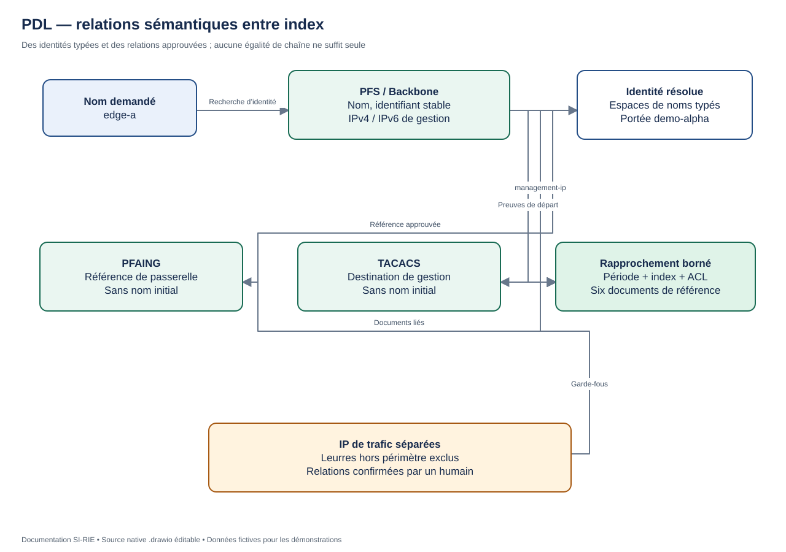
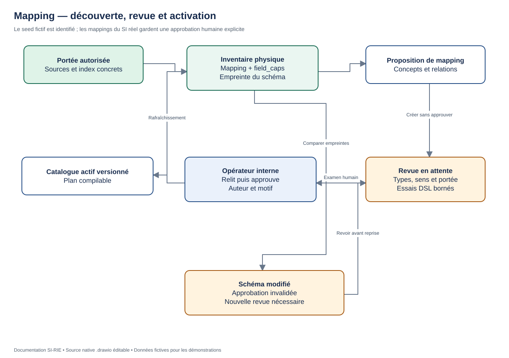

# Technique PDL : de la question aux preuves

> Complément de référence — le [guide principal](../README.md) reste le seul parcours de déploiement à exécuter.

Le moteur portable transforme une question métier en lectures bornées. Le
contrat MCP est `investigate_pdl(question, continuation_token='')` : aucun DSL,
nom de champ arbitraire, email ou rôle n'est transmis comme autorisation.


[Source draw.io du flux PDL](../diagrams/03-pdl-flow.drawio)

## Dialogue et validation

Le backend reçoit le message complet et le dernier jeton de reprise émis pour
cette conversation. Il distingue nouvelle question, précision, modification,
relance et annulation. L'état est lié au sujet authentifié. Il conserve l'intention
et ses précisions, pas d'anciennes observations comme résultat courant.

Dans le profil Open WebUI portable, le filtre protège le message et le jeton
de reprise avant l'appel MCP. Le modèle de relais sélectionne seulement la
fonction, avec le marqueur technique `question: ""` ; le callable protégé transmet les
valeurs exactes au serveur. La signature MCP réelle reste inchangée. Le relais
ne reçoit ni question métier, ni jeton opaque ni anciennes preuves ; la planification Albert
et les autorisations du backend restent les mêmes.

Un comptage autonome, avec période complète, périmètre approuvé et une source
courante non ambiguë, repart de sa propre question. Il n'hérite pas d'un ancien
équipement omis, même si l'interpréteur propose une suite de conversation.
Cette protection ne s'applique pas aux formulations référentielles (« ce même
équipement », « encore », « aussi »), aux questions incomplètes ni à plusieurs
sources possibles. Les autres transitions restent interprétées par Albert.

Une recherche d'équipement autonome suit la même règle lorsqu'elle nomme
l'équipement, ses sources, un périmètre approuvé et une période complète.
Elle ne reprend donc pas le critère de refus d'un ancien comptage. Les demandes
de conservation ou d'ajout (« mêmes filtres », « aussi ») gardent leur contexte.
Une date civile complète sans heures signifie la journée entière ; ce contrôle
ne change pas les règles de dates, de compilation ou d'autorisation.

Le planner propose un objet structuré : source, index, opération, période,
filtres, regroupement et limite. Le serveur valide ce plan contre l'inventaire,
le catalogue approuvé et les bornes de la configuration. Une ambiguïté demande
une clarification ; un mapping absent ou modifié ouvre une revue humaine.
Un résultat `awaiting_human` n'est pas une réponse métier publiable.

Une seule correction de proposition est autorisée pour trois ambiguïtés
techniques : une référence que les relations approuvées permettent au moteur
de retrouver, un nom de source pris pour un équipement dans un comptage,
ou deux sélections successives de sources prises pour une contradiction.
La correction repart de la demande originale et du catalogue courant ; les
affirmations du premier plan non validé ne sont pas réinjectées. Pour la
réparation d'identité, Albert extrait le nom, FQDN, IP ou identifiant demandé,
les sources cibles et les éventuels critères supplémentaires, dans une fonction
structurée imposée par le fournisseur. Il ne reçoit pas le schéma physique pour
cette extraction. Les dates et le périmètre confirmés restent contrôlés côté
serveur. Les critères supplémentaires ne peuvent pas être supprimés pour
obtenir un résultat : s'ils ne sont pas pris en charge, une précision est demandée.

Python choisit ensuite un unique ensemble de relations d'identité déjà
approuvées. Plusieurs ensembles possibles, une ancre absente ou des arguments
invalides entraînent une clarification ou un refus avant lecture. Les sources
ajoutées pour résoudre l'identité n'élargissent pas les cibles de logs demandées.
Les références intermédiaires sont lues par le moteur ; elles ne sont pas
réclamées à l'utilisateur lorsque les relations approuvées permettent de les
retrouver. Le plan reste soumis aux validations habituelles des schémas,
relations, budgets et ACL. Cette fonction interne de structuration n'ajoute
aucun outil MCP public.

Les deux propositions éventuelles sont comptées dans `planner.attempts` ;
`planner.repair` indique le motif. Aucun nouvel essai de transport n'est ajouté.
Une ambiguïté métier persistante reste une clarification explicite.

Pour une sélection de sources remplacée, cette réparation reprend les derniers
choix reconnus dans le catalogue actif avant de choisir le pool d'identité.
Cette réparation ne contourne pas une clarification portant sur une addition,
une contradiction dans le message courant ou un critère non pris en charge.
Les cibles inconnues ou mal formées
ne sont pas effacées pour obtenir un succès. Il s'agit du même budget de deux
propositions au maximum, sans nouvel essai de transport.

Avant la validation du plan, les noms et alias du catalogue courant servent
aussi à contrôler les cibles de logs explicitement demandées. Une source
nommée ne peut être oubliée par le modèle ; une exclusion est conservée, y
compris après un changement de recherche. Seules les sources déjà approuvées
et nommées par l'utilisateur peuvent compléter une proposition partielle.
Cette correction ne fournit pas une ancre absente et ne valide aucun mapping.
Une exclusion seule n'élargit jamais une mauvaise sélection du modèle.
Les synonymes interprétés par Albert restent préservés lorsqu'une liste n'est
pas entièrement reconnue localement. Un alias administré ambigu, un index inconnu
ou une sélection mal formée reste soumis au refus avant lecture.
Une nouvelle sélection de sources exprimée sans noms reconnus localement n'est
pas écrasée par une ancienne restriction. Le planificateur l'interprète, puis les
validations habituelles des sources, relations, budgets et droits s'appliquent.
Même lorsqu'une demande est classée comme une relance, le dernier message est
conservé ; ses critères explicites ne sont pas remplacés par l'ancien plan.

Le compilateur construit le DSL. Les seules requêtes exécutées sont celles
acceptées par les garde-fous et les droits de l'utilisateur. Le résultat contient
les faits, la requête réellement exécutée, la provenance et les limites de lecture.

## Quatre familles du corpus portable

| Famille | Index fictif | Utilité dans la démo |
| --- | --- | --- |
| PFS | `rie-pfs-fixture` | Actions de filtrage, portée et identités structurées |
| Backbone | `rie-bb-fixture` | Équipements, adresses de gestion et agrégations |
| PFAING | `rie-pfaing-fixture` | Événements et référence de passerelle, sans reprendre forcément le nom initial |
| TACACS | `rie-tacacs-fixture` | Événements reliés par IP de gestion, y compris IPv6 |

Le corpus est fixé au **12 octobre 2026 de 08:00 à 09:00 UTC** pour les questions
ci-dessous. Ses champs sont structurés ; la cible ne dépend pas d'une extraction
générale de `event.original` pour reconnaître un équipement.

## Périmètre et budgets à configurer

L'opérateur règle ces valeurs dans `config/pdl.yaml`, sur le serveur Ubuntu,
avant la validation et le redémarrage de l'instance. Les mêmes clés figurent
dans le modèle `deploy/ubuntu/examples/pdl.json`.

| Clé | Défaut | Borne admise et effet |
| --- | --- | --- |
| `discovery.max_indices` | 20 | 1 à 200 index physiques découverts et participants à une résolution d'identité |
| `discovery.max_fields_per_index` | 500 | 1 à 10 000 champs par index ; aucun champ n'est supprimé silencieusement |
| `discovery.required_index_patterns` | liste vide | Un index résolu avec mapping actif au hash du dernier inventaire est nécessaire pour chaque motif ; si la liste est vide, chaque motif de `allowed_index_patterns` est requis |
| `limits.max_identity_documents` | 1 000 | 1 à 10 000 documents par lecture d'identité, indépendamment de la limite des logs affichés |
| `limits.max_context_bytes` | 1 048 576 | 1 à 1 048 576 octets pour la requête complète au planner, à adapter à la capacité du modèle |

Déclarer les familles métier nécessaires par des motifs distincts dans
`required_index_patterns`. Avec un seul motif large comme `rie-*`, la disponibilité
d'une famille peut satisfaire ce seul motif : elle ne prouve pas la présence des
quatre familles. La préparation de démonstration déclare les quatre index fictifs
comme sources requises. Le résultat `/readiness` détaille les motifs satisfaits
et manquants ; la présence d'un seul mapping approuvé ne suffit plus à valider
plusieurs motifs requis.
Cette couverture minimale par motif ne garantit pas que tous les index physiques
d'un rollover possèdent déjà un mapping approuvé.

Une résolution examine tous les documents d'identité de chaque lecture avant
d'accepter l'ancre. Un équipement ayant plus de 50 événements peut ainsi être
résolu dans le budget configuré. Si le total dépasse ce budget, le résultat est
`incomplete` et les logs cibles ne sont pas lus. Après examen, les preuves
d'identité regroupent les jeux d'identifiants identiques avec un document
représentatif et `equivalent_documents` ; cette présentation ne remplace aucune
vérification d'ambiguïté.

Le transport conserve une limite de **2 Mo (2 000 000 octets) par réponse OpenSearch** et ses
délais de lecture. Augmenter le nombre de documents autorisés ne garantit donc
pas que des documents volumineux seront acceptés. Le scan temporaire de texte
brut, lorsqu'il est explicitement approuvé, reste soumis au même budget.
Les lectures successives ne constituent pas un instantané transactionnel du
cluster ni une preuve de causalité.

Le planner reçoit les champs des mappings courants pour les index approuvés,
et le schéma découvert pour les index encore à revoir. Il conserve tous les
index autorisés du contexte ; une requête trop grosse est refusée avant l'appel
IA avec une indication du budget dépassé. Le budget en octets ne mesure pas les
tokens disponibles du modèle.

Pour ajuster un budget, partir d'un échantillon représentatif et d'un besoin
métier, réduire si possible les motifs, la période ou le périmètre, puis rejouer
les cas nominaux, ambigus et interdits. Une limite admise par la configuration
n'est pas une capacité de charge mesurée. Rollover, cardinalités, documents
volumineux, données arrivant pendant les lectures et évolution des valeurs
métier restent à recevoir dans le SI-RIE, selon la
[matrice de recette](14-si-rie-acceptance.md). Un changement de schéma invalide les
approbations lors de sa détection par un rafraîchissement ; `/readiness` résout
les noms d'index en direct mais compare les approbations au dernier inventaire
local, sans relire tous les schémas. Une simple modification des valeurs, sans changement de schéma,
n'établit aucune nouvelle validation sémantique automatique.

## Relations entre index



[Source draw.io des relations](../diagrams/06-index-relations.drawio)

Une relation approuvée associe des concepts de même sens. Le runtime peut
retrouver une identité à partir d'un nom, puis relier IP de gestion, identifiant
stable et référence de passerelle. Une égalité de valeur n'est pas une preuve
que deux champs ont le même rôle. Les adresses de trafic restent distinctes des
adresses de gestion.

Pour la fixture `edge-a`, le scénario croisé de référence retrouve six documents
sur les quatre familles. Les documents PFAING et TACACS utiles n'ont pas besoin
de recopier le nom `edge-a`. Les leurres d'un autre périmètre doivent rester exclus.

## Revoir puis approuver les mappings

### Définir le mapping dans le SI réel

**Le fichier opérateur `config/mappings.yaml` décrit les correspondances
souhaitées ; les revues préparent leur validation ; le catalogue approuvé est
la configuration réellement utilisée par les recherches.** Ce fichier appartient
au PoC. Il ne redéfinit pas le mapping natif ni les données d’OpenSearch.

Le portail Ubuntu fournit **Mappings PDL** (`/admin-mappings`) aux comptes
LDAP administrateurs habilités. Il propose les champs découverts, détecte les
types, vérifie les propositions, présente les différences et demande une
approbation explicite. Le [parcours guidé de déploiement](../README.md#8-revoir-et-approuver-les-mappings-pdl)
décrit chaque action. Le YAML reste disponible pour l’import/export et les
commandes `manage.py pdl` pour l’exploitation sans portail. L’interface autonome
historique `rie_agent/admin_app.py` reste distincte et n’est pas installée dans
cette image Ubuntu.

Captures du **16 novembre 2026**, obtenues par navigateur sur une instance de
qualification Ubuntu distincte, avec le SI fictif : [formulaire guidé](../assets/screenshots-2026-11-16/mapping-editor.png)
et [revue des différences](../assets/screenshots-2026-11-16/mapping-review.png).
Elles illustrent les contrôles réels, sans valoir approbation des données du SI
ni des quatre revues de la recette manuelle.

Dans le SI réel, l’opérateur associe un concept métier à un chemin de champ
avec le responsable des sources et le métier. Exemples illustratifs à vérifier
sur les données réelles, sans présumer leur présence dans le SI-RIE :

| Concept du PoC | Champ physique possible | Ce qu’il faut confirmer |
| --- | --- | --- |
| `timestamp` : heure de l’événement | `@timestamp` | Heure de l’événement ou de sa collecte, format et fuseau. |
| `equipment` : équipement concerné | `observer.name` | Nom de l’équipement qui produit le log, distinct d’un poste client ou d’une destination. |
| `action` : action réseau observée | `event.action` | Sens exact des valeurs, par exemple `deny`/`allow`, en conservant leur casse réelle. |
| `network_scope` : périmètre réseau métier | `network.scope` | Signification du périmètre et valeurs autorisées pour les questions prévues. |
| `management_ip` : IP de gestion | `observer.ip` | Adresse de gestion de l’équipement, distincte des IP de trafic `source.ip` et `destination.ip`. |

Le parcours est le suivant :

1. Faire fournir les index physiques, leurs schémas et des exemples autorisés,
   puis les questions/résultats de référence avec les responsables du SI.
2. Déclarer les index autorisés dans `pdl.yaml` et les ACL, puis exécuter
   `refresh` pour découvrir leurs champs, types et capacités. Des profils prédéfinis peuvent
   suggérer des candidats ; noms et types ne suffisent pas à confirmer leur sens.
3. Choisir les concepts, champs et valeurs dans le formulaire, ou renseigner
   `match`, `concepts`, `field` et les types dans `config/mappings.yaml`. Pour les rapprochements, déclarer dans `relations`
   uniquement des identités dont l’équivalence est confirmée. Deux champs de type
   `ip` ne prouvent pas qu’ils désignent le même équipement.
4. Cliquer **Vérifier la proposition** ou exécuter `validate-mappings`. `valid: true` démontre la cohérence technique
   avec l’inventaire ; il ne constitue pas une validation métier.
5. **Enregistrer une proposition**, puis **Examiner cette revue** ; en CLI,
   utiliser `load-mappings` puis `inspect --review-id`. L’import reste en attente et n’active pas le fichier.
6. Après revue métier, l’administrateur LDAP habilité approuve chaque index
   physique avec **Approuver ce mapping** ou `approve-review`, et un motif. Le système conserve auteur,
   justification, version et empreinte de schéma. Rejouer ensuite les questions
   de référence pour vérifier les résultats et les refus attendus.

Un fichier peut sélectionner plusieurs index avec un motif borné, mais chaque
index physique nécessite sa revue. Une nouvelle génération d’index doit donc
être découverte et approuvée. Un changement de schéma détecté au rafraîchissement
invalide les versions concernées ; réexaminer le mapping avant de reprendre.
Le mapping ne remplace jamais l’autorisation ACL de lire l’index.

### Commandes de revue sur Ubuntu



[Source draw.io du cycle de revue](../diagrams/07-mapping-approval.drawio)

Depuis le serveur Ubuntu, avec l'identifiant LDAP interne de l'opérateur :

```bash
# Relit les schémas autorisés et actualise l'inventaire et les revues PDL ; n'approuve aucun mapping.
sudo python3 deploy/ubuntu/manage.py pdl "$RIE_INSTANCE" --username LDAP_USERNAME -- refresh
# Affiche l'inventaire, le catalogue actif et les revues en attente pour l'identité de l'opérateur.
sudo python3 deploy/ubuntu/manage.py pdl "$RIE_INSTANCE" --username LDAP_USERNAME -- inspect
```

La découverte relit le schéma et ses capacités. Un changement invalide les
approbations concernées. Pour un fichier opérateur relu dans `config/mappings.yaml` : le modèle public
`deploy/ubuntu/examples/mappings.yaml` permet de commencer sur un index réel.
Le copier seulement dans une instance externe neuve et adapter les champs avec
le responsable métier. Le fichier n’est ni un catalogue actif ni une approbation.
L’option `--input` ouvre le fichier avec les droits de la commande ; elle évite
une redirection shell qui échouerait sur un fichier privé à root.

Puis :

```bash
# Vérifie le fichier de propositions de mappings fourni ; ne l'active pas.
sudo python3 deploy/ubuntu/manage.py pdl "$RIE_INSTANCE" --username LDAP_USERNAME --input "$RIE_INSTANCE/config/mappings.yaml" -- validate-mappings
# Importe les propositions de concepts et relations pour créer des revues ; leur approbation reste manuelle.
sudo python3 deploy/ubuntu/manage.py pdl "$RIE_INSTANCE" --username LDAP_USERNAME --input "$RIE_INSTANCE/config/mappings.yaml" -- load-mappings --reason "Revue métier des concepts et relations"
# Affiche la revue indiquée pour vérifier les champs, relations et preuves avant toute approbation.
sudo python3 deploy/ubuntu/manage.py pdl "$RIE_INSTANCE" --username LDAP_USERNAME -- inspect --review-id REVIEW_ID
# Approuve la revue identifiée après contrôle métier ; cette action rend le mapping utilisable.
sudo python3 deploy/ubuntu/manage.py pdl "$RIE_INSTANCE" --username LDAP_USERNAME -- approve-review REVIEW_ID --reason "Champs et relations confirmés"
```

L'import crée des revues en attente. Relire les champs, types, portée et relations
avant l'approbation d'un identifiant précis. Le seed fictif peut activer les seuls
mappings embarqués après contrôle de leur schéma ; son auteur est identifié comme
fixture de démonstration, pas comme une nouvelle décision humaine sur le SI réel.

## Retrouver une erreur

Les lectures de champs `_source` et empreintes JSON utilisent
`rie_agent/documents.py`, partagé avec le moteur Mac depuis le 11 novembre.
Ce module ne charge ni configuration ni client de source. Les formats des
empreintes, les noms importés existants et les approbations persistées restent
compatibles ; la mutualisation n'active aucun mapping.

Les points d'entrée sont `rie_agent/mcp_app.py`, `service.py`, `planner.py`,
`inventory.py`, `opensearch.py`, `mappings.py`, `equipment.py` et `store.py`.
Commencer par le résultat structuré, le statut, le plan validé et le DSL exécuté.
Un ancien rapport ne se recalcule pas automatiquement après correction d'un mapping.

Ne pas confondre : mapping approuvé, droit d'accès à l'index et disponibilité
physique de la source. Chacun possède son propre contrôle et sa propre cause
d'échec. Voir [ACL](06-acl.md) et [Exploitation](07-operations.md).
