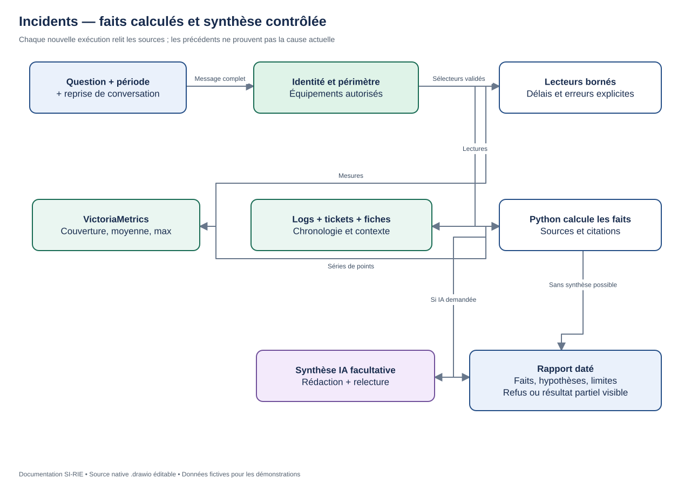

# Technique Incidents : du périmètre au diagnostic

> Complément de référence — le [guide principal](../README.md) reste le seul parcours de déploiement à exécuter.

Le moteur Incidents rapproche des mesures, alertes/tickets, logs et fiches
historiques. Python calcule les faits et les périodes ; le fournisseur IA rédige
et relit la synthèse lorsqu'elle est demandée et disponible.

Le lot [ITSM-NG 1.6.17](15-itsm-precedents.md) ajoute, sur activation explicite,
des précédents réels ou fictifs et une solution proposée avec confiance argumentée.
Il conserve la chronologie et les faits du diagnostic ; son raccordement historique
est distinct du snapshot actuel d'alertes. Sa recette métier et SI est séparée.



[Source draw.io du flux Incidents](../diagrams/04-incidents-flow.drawio)

## Contrats et périmètre

Le client utilise `diagnose_observability(question, continuation_token='')`
par MCP. Il transmet le message complet et le dernier jeton de reprise du
serveur, sans inventer un équipement ou une période. L'URL de la livraison
est `/gptoss/assistant/mcp`, avec un Bearer individuel.

Le filtre optionnel Open WebUI capture ce message et le jeton avant le relais.
Le modèle de relais ne reçoit qu'une commande de transport constante et le
marqueur `question: ""`. Le callable protégé transmet au MCP les deux valeurs
réelles ; la signature du serveur reste inchangée. Le backend reçoit toujours
la vraie demande pour l'interprétation Albert, les lectures autorisées et la
rédaction/relecture. Le relais ne sert ni à choisir les droits ni à interpréter
les symptômes. Le client qualifié est Open WebUI 0.11.3 ; une autre version
doit être vérifiée sur le contrat des filtres et les parcours utilisateur.

Le serveur normalise l'équipement ou le périmètre autorisé, puis les bornes
horaires. Une période est explicite, avec fuseau, positive, de sept jours
maximum et sans date future. Les fenêtres sont traitées comme des intervalles
`[début, fin)` : un point situé exactement à la fin appartient à la fenêtre suivante.
Un diagnostic est limité à dix équipements.

Le manifeste opérateur déclare aussi `status: ready`, `synthetic`, `timezone`,
`anchor_date`, `start`, `end` et `interval_seconds`. La fenêtre `start/end` est
la **fenêtre de contrôle de disponibilité**, à choisir là où des données sont
connues ; elle ne borne pas toutes les recherches métier. Les dates de corpus
de démonstration ne doivent pas être recopiées comme dates de données du SI.
Le validateur refuse un manifeste externe incomplet avant le démarrage.

Une information manquante renvoie une clarification. Le jeton de reprise est
lié à l'identité et n'est pas une copie de preuves anciennes. Une nouvelle
exécution relit les sources et les droits.

Une demande visant un nouvel équipement peut reprendre explicitement « ce même
créneau » : seules les dates confirmées du contexte signé sont conservées si
l'interpréteur classe cette demande comme nouvelle. L'équipement et le périmètre
doivent être résolus depuis la nouvelle question. Une date complète nouvelle
remplace ces bornes ; une date invalide provoque une clarification. Le préfixe
`Nouvelle demande :` réinitialise le contexte.

Comparer les observations aux précédents ITSM est distinct d'une comparaison
temporelle. Ce premier objectif n'autorise pas de seconde lecture de mesures ;
une comparaison temporelle demandée en plus exige ses propres bornes.

## Sources du corpus de référence

| Source | Ce qui est réellement lu |
| --- | --- |
| VictoriaMetrics | CPU, latence, pertes et utilisations entrante/sortante |
| OpenSearch PDL | Logs d'équipements sur la fenêtre du diagnostic |
| Tickets simulés | Début d'alerte, résolution technique, traitement et clôture administrative |
| OpenSearch documentaire | Fiches techniques et précédents, par recherche lexicale bornée |

Le corpus fixe la collecte au **28 septembre 2026 de 09:00 à 13:00 Europe/Paris**.
La fenêtre de démonstration principale va de 10:00 à 12:00. R1 présente des
signaux compatibles avec une congestion ; R2 avec une liaison instable ; R3
conserve une interruption de collecte. Un quatrième équipement est exclu du
périmètre autorisé.

Aucun identifiant Zabbix historique n'est nécessaire quand les mesures viennent
de VictoriaMetrics et les événements du simulateur ITSM. Les URLs de lecteurs
web facultatifs absents restent vides ; aucune adresse Grafana ou portail du
poste développeur ne doit être inventée dans les citations.

## Calculs et sens métier

Le serveur calcule nombre de points, cadence attendue, couverture, moyenne et
maximum. Une mesure manquante ne signifie ni zéro ni réseau sain. Les doublons
horodatés et les valeurs non finies sont contrôlés. Les événements sont rapprochés
de la fenêtre pour calculer leur durée de recouvrement.

La cadence appliquée à chaque mesure, y compris la période de référence, suit
cet ordre : `hosts[].metric_intervals_seconds.<métrique>`, puis
`metric_intervals_seconds.<métrique>` du manifeste, puis `interval_seconds`.
Le résultat expose `interval_seconds` et le nombre de points attendu. Par exemple,
dix points espacés d'une minute sur dix minutes couvrent 100 % d'une collecte
prévue toutes les minutes, mais 16,67 % d'une collecte prévue toutes les dix
secondes. L'opérateur doit confirmer la cadence réelle avec la supervision.

## Adapter les sources externes

Les noms des séries, labels fixes, correspondances avec l'inventaire et facteurs
d'échelle sont définis dans `metric-mapping.json`. Chaque entrée de `metrics`
peut définir ses propres `bindings` et `fixed_labels` : le CPU peut être attaché
à un équipement sans label d'interface, les entrées/sorties à une interface.
Les bindings autorisés sont `equipment`, `interface`, `hostid` et `scope`.
Une entrée `bindings` remplace les bindings communs ; ses labels fixes complètent
ou remplacent les labels fixes communs. Le lecteur exige une série exacte ;
plusieurs séries ne sont jamais additionnées silencieusement.

Le manifeste peut adapter les champs OpenSearch avec `source_fields.logs` et
`source_fields.documents`. Les noms canoniques restent ceux de la livraison :
logs `record_id`, `@timestamp`, `equipment`, `scope`, `interface`, `event_code`,
`message` ; documents `record_id`, `kind`, `title`, `text`, `equipment`, `date`,
`keywords`, `allowed`. Un chemin simple remplace le nom du champ. Un objet permet
de distinguer le `_source` d'un sous-champ `keyword` utilisé pour les filtres :

```json
{
  "source_fields": {
    "logs": {
      "equipment": {"source": "host.name", "query": "host.name.keyword"},
      "@timestamp": "event.created",
      "record_id": "event.id"
    },
    "documents": {
      "record_id": "document.id",
      "equipment": {"source": "host.name", "query": "host.name.keyword"}
    }
  }
}
```

Les champs omis conservent les noms actuels. Les requêtes, agrégations, champs
renvoyés et liens de citation utilisent ce même contrat. Les identifiants de logs
et de documents sont des chaînes de 1 à 128 caractères alphanumériques, avec
point, tiret, soulignement ou deux-points après le premier caractère. Les champs
de filtre/agrégation doivent être exacts (`keyword`) et l'horodatage de type date.
Les clés canoniques, chemins et limites sont validés ; aucun script ou DSL de
requête libre n'est accepté dans ces fichiers.

Cette adaptation ne transforme pas un compteur SNMP en pourcentage, n'agrège
pas des CPU par cœur et ne découvre pas automatiquement les interfaces ou le
ticketing. Ces données doivent être normalisées en amont en jauges compatibles
avec les unités attendues, avec provenance et méthode validées. La sémantique
des codes d'événements doit également être vérifiée. Le snapshot ITSM conserve
son contrat normalisé explicitement simulé pour la chronologie courante.
Le connecteur natif de recherche des précédents ITSM-NG est distinct et décrit
dans le [lot ITSM](15-itsm-precedents.md) ; l'alimentation de la chronologie
courante par une API réelle n'est pas incluse dans ce lot.

Le lecteur VictoriaMetrics applique le budget restant du diagnostic avant toute
connexion et une annulation totale couvrant connexion, en-têtes et corps, même
si un flux lent n'émet jamais une ligne complète. Les lectures suivantes sont
refusées dès épuisement du budget. Les limites de taille et de points restent
appliquées ; un dépassement rend le diagnostic partiel avec un code d'erreur.

Les lectures HTTP OpenSearch et Zabbix appliquent également une annulation
sur le temps restant pendant connexion, en-têtes et réception du corps. Leur
réponse JSON est bornée à **2 000 000 octets avant décodage** ; un dépassement
renvoie `response_limit`. Le transport demande `Accept-Encoding: identity` et
refuse une compression imposée par le serveur ou le proxy avec
`unsupported_content_encoding`. Les erreurs d'accès, de connexion et de délai
restent distinctes. Des données volumineuses demandent une projection ou une
normalisation adaptée ; elles ne désactivent pas ces protections.

La **résolution technique de l'alerte** et la **clôture administrative du ticket**
sont deux faits distincts. Le statut courant `closed` ne prouve pas qu'un ticket
était fermé à l'heure étudiée. Les fiches anciennes sont des précédents et des
conseils de vérification, pas la preuve d'une cause actuelle.

## Synthèse IA et refus

Les chiffres et citations sont produits par le serveur. La rédaction doit rester
fondée sur ces preuves, distinguer hypothèse et cause démontrée, et reconnaître
les absences. Une étape de contrôle et les validations Python peuvent refuser
une synthèse incorrecte. Une panne ou un délai Albert ne doit pas fabriquer un
résultat complet.

La relecture reçoit le rôle des sources : observations de la fenêtre, contexte
technique ou historique. Une hypothèse qui cite un précédent doit aussi citer
une observation et s'affiche comme « Piste par analogie, à confirmer ». La
ressemblance des symptômes ou une réparation passée ne démontre pas la cause
actuelle ; un fait absent du ticket ou une solution refusée présentée comme
acceptée restent des motifs de rejet.

La rédaction peut reprendre un horaire exact en Europe/Paris lorsque la fenêtre
couvre un seul jour : les repères des événements, tickets, bornes de fenêtre et
l'heure explicitement demandée sont contrôlés. Les dates exactes de la fenêtre étudiée peuvent aussi être reprises. Les horaires
et dates inconnus, ainsi que les mesures chiffrées dans la rédaction, restent refusés. La relecture voit
le texte original et la chronologie complète ; elle doit aussi refuser un horaire
exact attribué au mauvais fait, par exemple une clôture confondue avec une
résolution. Cette vérification ne s'applique pas automatiquement aux heures UTC,
aux fenêtres de plusieurs jours ou aux heures civiles ambiguës.
Les identifiants connus peuvent employer un tiret typographique : seule leur
comparaison est normalisée, sans modifier le texte soumis à la relecture.

Les noms d'interface suivent les preuves autorisées : champ d'inventaire repris
dans les métriques, champ structuré des logs ou mention explicite d'interface/port
dans une fiche ou un événement. La validation ne contient plus d'exception pour
un nom du corpus de démonstration. Les correspondances respectent les noms
complets ; une interface inconnue et une mesure inventée restent refusées.

Une question fermée limitée à l'état de l'alerte et du ticket à une heure
confirmée reçoit directement la réponse calculée depuis les nouvelles lectures
des sources (`synthesis_mode: source_facts`). Aucune synthèse IA supplémentaire
n'est demandée : ce cas ne compte pas comme validation d'une génération Albert.
Les demandes d'explication et les questions mixtes conservent la génération et
la relecture. Un diagnostic incomplet reste signalé comme tel.
Lorsque le contexte signé est déjà confirmé, le backend n'effectue aucun
appel Albert pour ce suivi, y compris pour l'interprétation : il peut être enchaîné
sans attendre son délai des appels IA. Le client Open WebUI utilise toujours son
modèle pour émettre l'appel MCP. Les droits et les sources restent relus. Un résultat
`rate_limited` conserve le jeton de continuation pour la prochaine tentative.

Pour la recette technique, l'API HTTP `/diagnose` accepte `synthesize: false` :
elle exerce les lecteurs et calculs sans génération. Cette recette ne qualifie
pas le dialogue naturel ni la qualité du modèle. La limitation de cadence des
synthèses est une protection du fournisseur ; elle est testée séparément des
performances des sources.

## Retrouver le code et les preuves

Le transport est dans `obs_poc/server.py`, le dialogue dans `assistant.py`,
les calculs et périodes dans `domain.py`, l'orchestration dans `service.py`,
les lecteurs dans `clients.py` et `telemetry.py`, les contrats dans `contracts.py`. Le mapping de métriques, le
manifeste et le snapshot ITSM sont des entrées opérateur versionnées ou privées.

Le résultat structuré conserve contexte, mesures, événements, logs, documents,
sources, erreurs et limites. La date du rapport et la date des observations
restent distinguées. Un nouvel appel produit de nouvelles lectures ; il ne
transforme pas une ancienne réponse en preuve courante.


## Correction bornée après une synthèse refusée

Avec le modèle fixe du PoC, le serveur autorise une correction pour les contrôles
locaux et une pour la relecture factuelle. Leurs motifs sont conservés ensemble. Si la première rédaction
passe les contrôles mais est rejetée par Albert, son motif est transmis à une
nouvelle rédaction depuis les mêmes preuves autorisées. Cette seconde rédaction
doit à nouveau passer les contrôles et une relecture. Les sources ne sont pas
recollectées pendant cette correction et aucune limite d'admission n'est désactivée.

Cela représente au plus trois rédactions et deux relectures pour la synthèse,
hors interprétation du dialogue, dans le budget global de durée existant. Le tableau des appels indique
le numéro d'essai. Les rejets restent tracés. Si ces corrections échouent, le diagnostic
reste partiel, avec le motif du refus disponible ; aucune solution qualifiée n'est
publiée. Une réponse factuelle et une solution historique ne deviennent pas des
causes démontrées parce qu'une rédaction corrigée est validée.


Le profil Ubuntu qualifié sépare les rôles sur Albert : Gemma 4 rédige et
GPT-OSS relit. Les identifiants retournés sont conservés pour chaque étape.
Changer le rédacteur ne change ni les calculs ni les droits ; changer le
relecteur exige aussi de vérifier ses refus sur des affirmations mal étayées.
