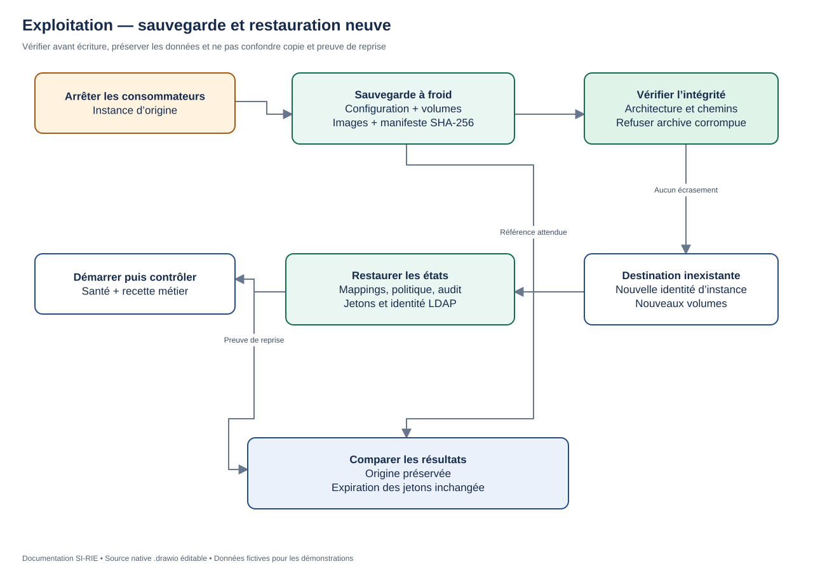

# Exploiter, sauvegarder et reprendre l'instance

> Complément de référence — le [guide principal](../README.md) reste le seul parcours de déploiement à exécuter.

Ces commandes se lancent sur le **serveur Ubuntu**, à la racine des sources
remises, avec l'opérateur `sudo` retenu à l'installation. Après chaque nouvelle
connexion SSH, redéfinir le chemin absolu, par exemple :

```bash
# Choisit le dossier privé du PoC ; exemple demo à adapter au chemin de votre instance.
export RIE_INSTANCE=/home/dinum/.local/share/dinum-rie-demo
```

Conserver le même chemin et le bon contexte Docker. Ne pas déplacer des volumes
entre instances ni laisser `sudo` choisir une instance sous `/root`.

## Lire l'état sans interrompre le service

```bash
# Affiche l'état des conteneurs de cette instance ; ce contrôle seul ne valide pas les données ni Albert.
sudo python3 deploy/ubuntu/manage.py status "$RIE_INSTANCE"
# Sonde les sources, le LDAP et les mappings ; ready signifie disponibilité métier, sans validation de génération Albert.
sudo python3 deploy/ubuntu/manage.py check "$RIE_INSTANCE"
```

`status` décrit les processus ; `check` vérifie sources, LDAP, catalogue et
initialisation métier, avec code non nul si l'instance n'est pas prête.
En `external`, ajouter `--username LDAP_USERNAME` à tous les `check`
de cette page. Albert conserve une recette distincte.

Pour les journaux d'un service et l'occupation locale :

```bash
# Affiche les cent dernières lignes du backend PDL pour le dépannage ; ne modifie ni n'arrête le service.
sudo python3 deploy/ubuntu/manage.py logs "$RIE_INSTANCE" --service pdl --tail 100
# Mesure l'espace disque et la taille des rapports et états de cette instance, sans les supprimer.
sudo python3 deploy/ubuntu/manage.py storage "$RIE_INSTANCE"
```

Attendu : cent dernières lignes au plus, puis nombres de fichiers/octets par
zone et état du disque. Choisir `incidents` ou `portal` pour le service concerné
si présent. `storage` ne lit pas les contenus des preuves, ne purge rien et
n'installe aucune pile d'observabilité. Examiner les logs en privé ; même une
sortie technique ne se copie pas sans revue dans un ticket public.

En cas d'échec du dialogue Incidents, conserver l'identifiant `request_id` du
résultat et examiner les journaux `incidents`. La ligne `incident_turn_failed`
contient cet identifiant, l'étape `phase` et un code fermé, sans question,
réponse brute Albert ni secret. `dialogue_invalid_json`,
`dialogue_invalid_response` et `dialogue_invalid_decision` indiquent un contrat
d'interprétation refusé ; `provider_unavailable` signale un échec du client Albert.
Une seule réparation de format est autorisée, avec un budget de 4 096 tokens
par réponse et un délai total de soixante secondes. Les échecs du client Albert
et les refus de quota ne sont pas relancés automatiquement ; leur code est
conservé dans le résultat. Un nouvel échec reste explicite et ne publie aucun
ancien diagnostic.

Les rapports de qualification se consultent depuis **Qualification** dans
NiceGUI, avec un compte interne habilité à l'administration. Leur
[import opérateur](13-test-reports.md#importer-puis-consulter-dans-nicegui)
n'arrête pas les services et ne lance aucun test. Conserver les ZIP et leurs
empreintes séparément de la sauvegarde applicative ; ils pourront être réimportés
après une restauration.

## Arrêter et reprendre volontairement

**Arrêter seulement lorsque l'interruption est voulue :**

```bash
# Arrête les services de cette instance en conservant ses volumes, configurations et secrets.
sudo python3 deploy/ubuntu/manage.py stop "$RIE_INSTANCE"
```

Attendu : services arrêtés, données, règles, mappings, secrets et jetons
conservés. Après cet arrêt volontaire :

```bash
# Démarre ou relance les services de cette instance et recharge sa configuration en conservant ses données.
sudo python3 deploy/ubuntu/manage.py up "$RIE_INSTANCE"
# Sonde les sources, le LDAP et les mappings ; ready signifie disponibilité métier, sans validation de génération Albert.
sudo python3 deploy/ubuntu/manage.py check "$RIE_INSTANCE"
```

Attendu : mêmes données et droits. Ne pas lancer de seed ou approuver un mapping
pour redémarrer. Les services `unless-stopped` reprennent avec Docker après
reboot lorsqu'ils n'avaient pas été explicitement arrêtés.
`up` recharge la configuration et recrée ses consommateurs ; prévoir une
interruption, même pour une modification de secret.

## Sauvegarder à froid



[Source draw.io](../diagrams/08-backup-recovery.drawio)

Prévoir une interruption, l'espace suffisant et un **nouveau** dossier hors
code et hors instance. Exécuter chaque commande après réussite de la précédente :

```bash
# Arrête les services de cette instance en conservant ses volumes, configurations et secrets.
sudo python3 deploy/ubuntu/manage.py stop "$RIE_INSTANCE"
# Sauvegarde l'instance arrêtée dans une nouvelle destination privée avec données, configuration et manifeste d'intégrité.
sudo python3 deploy/ubuntu/manage.py backup "$RIE_INSTANCE" --output /PRIVATE/PATH/rie-backup-DATE
# Démarre ou relance les services de cette instance et recharge sa configuration en conservant ses données.
sudo python3 deploy/ubuntu/manage.py up "$RIE_INSTANCE"
# Sonde les sources, le LDAP et les mappings ; ready signifie disponibilité métier, sans validation de génération Albert.
sudo python3 deploy/ubuntu/manage.py check "$RIE_INSTANCE"
```

Attendu : reçu `backup`, `manifest_sha256`, `images_included` et `data_archives`,
puis instance prête. Garder le paquet source correspondant et ce reçu. La copie
contient configuration, secrets, images et données locales, y compris rapports,
politique, mappings, audits et état des jetons ; ses empreintes sont vérifiées.
En `demo`, elle inclut aussi les sources fictives. En `external`, les responsables
des bases et du LDAP sauvegardent leurs systèmes séparément.

Si le backup échoue, l'instance source reste arrêtée : corriger ou reprendre
explicitement avec `up`, puis `check`. Un tag d'image ayant changé après création
d'un conteneur demande un `up` puis un nouvel arrêt avant sauvegarde. Ne pas
contourner ce contrôle. Une sauvegarde contient des secrets : stockage et remise
privés ; le ZIP documentaire public n'est jamais une sauvegarde de données.

### Conserver les rapports sans purge automatique

Les journaux Docker tournent avec des limites ; les rapports et audits métier
ne sont pas supprimés automatiquement. Lire `storage` après les séances de
recette et régulièrement selon la fréquence retenue par l'exploitant. Une
croissance attendue n'autorise pas à effacer les preuves d'autres utilisateurs.

Pour archiver une période, conserver une sauvegarde froide datée et son manifeste
hors du disque applicatif, puis en vérifier une restauration sur instance neuve.
La copie est complète : elle ne doit pas être présentée comme un export sélectif
de rapports. Décider la durée de conservation avec le responsable des données.
Aucune suppression ou rotation des preuves n'est activée par cette livraison.
Si le disque approche de sa limite, augmenter la capacité ou suspendre les
nouveaux essais pendant la décision, sans désactiver les contrôles d'accès.

## Restaurer dans une instance neuve

Sur le serveur de reprise de **même architecture**, avec le paquet source
correspondant à la sauvegarde, choisir une destination inexistante. Ne pas
exécuter `prepare`. Arrêter les consommateurs concernés, vérifier disque et
ports, puis :

```bash
# Vérifie la sauvegarde et la restaure dans une nouvelle instance ; ne démarre aucun service et ne remplace pas l'originale.
sudo python3 deploy/ubuntu/manage.py restore /PRIVATE/PATH/rie-restored --backup /PRIVATE/PATH/rie-backup-DATE
# Démarre ou relance les services de cette instance et recharge sa configuration en conservant ses données.
sudo python3 deploy/ubuntu/manage.py up /PRIVATE/PATH/rie-restored
# Sonde les sources, le LDAP et les mappings ; ready signifie disponibilité métier, sans validation de génération Albert.
sudo python3 deploy/ubuntu/manage.py check /PRIVATE/PATH/rie-restored
```

En `demo`, exécuter ensuite `acceptance` sur cette destination ; en `external`,
passer l'identifiant interne à `check` et rejouer les scénarios autorisés du SI,
sans seed. Comparer les données et droits attendus avant de remettre les clients.

La restauration vérifie les empreintes avant écriture, refuse la corruption,
crée de nouveaux volumes et une nouvelle identité d'instance. Elle conserve
règles, révisions, ressources UC2, mappings, audits, secrets et état des jetons
**à l'instant de la sauvegarde**. L'identité et les groupes LDAP sont relus, et
un jeton garde son échéance réelle ; en revanche, une révocation ou une règle
modifiée après la sauvegarde n'apparaît pas automatiquement dans la copie.
Avant de rouvrir l'accès utilisateur ou les tunnels vers cette copie, reporter
les révocations et changements décidés depuis la sauvegarde, ou réémettre puis
révoquer les jetons concernés selon la procédure retenue. Il n'existe ni
synchronisation ni rotation automatique de ces décisions.
`restore.json` indique `services_started: false` : `up` reste explicite.

Ne pas faire coexister les copies sur les mêmes ports. Un tag local conflituel
ou une architecture différente est refusé ; ne pas forcer un écrasement.
Après import partiel, examiner `restore-failed.json` et les seules ressources
créées, puis choisir une autre destination avec l'exploitant. Ne pas réessayer
à l'aveugle dans la destination partielle.

## Mettre à jour et revenir à l'état sauvegardé

1. Lire le bilan de la nouvelle version, ses migrations et les droits UC2.
2. Sauvegarder à froid ; conserver paquet source, manifeste et images associés.
3. Extraire et vérifier le nouveau paquet dans un autre dossier, garder le même
   `RIE_INSTANCE`, puis y exécuter `validate`, `build`, `pull` et `up`.
4. Rejouer `check` et la recette autorisée ; en `demo`, `acceptance` ne remplace
   pas la vérification des conversations et de la politique effectivement voulue.
5. Après succès, remettre les clients. Après échec, arrêter l'instance mise à
   jour et restaurer la sauvegarde dans une **nouvelle** instance avec son paquet
   source correspondant, selon la section précédente.

Le retour retenu est cette restauration vérifiée, pas un simple `cd` vers un
ancien checkout : le `.env` de l'instance peut encore sélectionner les nouvelles
images. Les clients reprennent sur la destination restaurée seulement après
contrôle de ses ports, droits et données. Les changements survenus depuis la
sauvegarde doivent être évalués avant cette décision ; ils ne sont pas fusionnés
automatiquement.

Pour une politique antérieure aux ressources UC2, suivre la
[migration explicite des droits](06-acl.md#reprendre-une-politique-antérieure-aux-droits-de-sources-uc2).
Ne pas changer le fichier initial pour ouvrir silencieusement une politique active.

## Réagir à une panne

| Symptôme | Contrôle et action |
| --- | --- |
| Docker inaccessible | Contexte, daemon, droit opérateur avant toute relance |
| Processus sain, instance non prête | Initialisation et dépendances de `check`, puis logs du service |
| Refus LDAP/jeton | CA, objet LDAP, groupes, expiration/révocation ; aucun compte partagé de substitution |
| Refus UC2 après mise à jour | Lire les deux index et les deux ressources de la politique, puis migration approuvée |
| Source métier indisponible | Rétablir la source et vérifier une nouvelle demande ; un ancien rapport ne prouve pas la reprise |
| Mesures incomplètes | Lire couverture/erreurs ; absence de mesures ne signifie pas réseau sain |
| IA lente ou indisponible | Conserver la limite de génération ; respecter délais et cadence, sans boucle automatique |
| Capacité des conversations atteinte | Examiner `storage`, capacité et expiration ; ne pas supprimer les états encore valides |
| Identité Docker/volume différente | Retrouver moteur et instance d'origine ; aucune suppression automatique |

Les états de reprise expirent et sont nettoyés lors d'émissions suivantes. Leur
présence expirée sur disque ne les rend pas utilisables. Cette exploitation
monohôte ne constitue pas une architecture de haute disponibilité ; ni sources
réelles ni serveur AMD64 ne sont qualifiés par le seul laboratoire ARM64.
